# Liang Cheng: Season 4

Detailed chronological story, evolution record, and illustrated form atlas.

Season 4 continues the struggle over Central Island's flesh income. It follows Liang Cheng through the confrontation with Floating Island, advancement into the divine realm, the parasitic crisis among his old companions, and the departure through the Heavenly Gate. The reviewed compilation runs approximately two hours and seventeen minutes. The account ends where that compilation ends, without adding events from the world beyond the gate.

The illustrations are original video stills with their captions and graphics intact. English names for new system terms are reference translations. Unselected evolution options, an enemy's abilities, and another mantis's advancement are kept separate from Liang Cheng's own progression.

## Evolution milestones

**Ultimate Middle → Ultimate High → Ultimate Superior → Ultimate Peak → Initial Divine Realm, Early Stage: Void Deity → Initial Divine Realm, Middle Stage.**

| Point in the season | Liang Cheng's confirmed state | Basis and consequence |
|---|---|---|
| Opening | Ultimate Form, Middle Stage carried over from Season 3 | The conflict begins over the established Central Island income. |
| Early Floating Island strategy scenes | Ultimate Form, High Stage | Muyu describes Liang's rapid progression through Early and Middle to High. This is dialogue evidence, not a newly invented transformation scene. |
| After the favorable trade agreement | Ultimate Form, Superior Stage | The original caption supplies the additional Chao stage label. It occurs after High and before the later Peak milestone. |
| Next promotion, before the first battle with Muyu | Ultimate Form, Peak Stage | Liang says he has reached the top of the form. The subsequent confrontation explicitly identifies him as being at its peak. |
| Preparation for divinity | Peak Ultimate, accumulating Divinity Points | The next target becomes 10,000 Divinity Points. He estimates about eighty further days at his current rate. This estimate is not a new form. |
| Completion of the secluded transformation | Void Deity, Initial Divine Realm, Early Stage | He chooses the Condensation route and emerges with a much smaller, slender purple body. The original panel supplies the new realm and form name. |
| Eating the ancient armored remains | Initial Divine Realm, Middle Stage | Consuming the shell supplies enough Divinity Experience for a promotion. The announcement mentions 35,000 points, and a nearby display shows 35,900. These readings are not converted into an exact reward formula or universal threshold. |
| Return to Floating Island | Same divine body, enlarged manifestation available | Heaven-and-Earth Manifestation reveals a gigantic true-body expression. It is an ability of the chosen route rather than an additional realm promotion. |
| Final battles and departure | Divine Liang Cheng; no further securely identified stage | He consumes the returning Muyu and kills Parasitic Demons, then leads the group through the gate. No additional named rank is added solely from those meals. |

**Superior Stage** is the English label used here for this season's additional Chao subdivision. It belongs within **Ultimate Form** and must not be confused with the earlier **Super Form** tier. Its position is established by the sequence of scenes; the reference does not invent a complete universal stage chart beyond what is shown.

Divinity Points before the breakthrough and Divinity Experience afterward are recorded separately. The references to Dazhuang's rapid promotions, his false Ultimate state, and his later drop to Ultimate Early belong to Dazhuang, not to Liang Cheng.

## The six divine evolution options

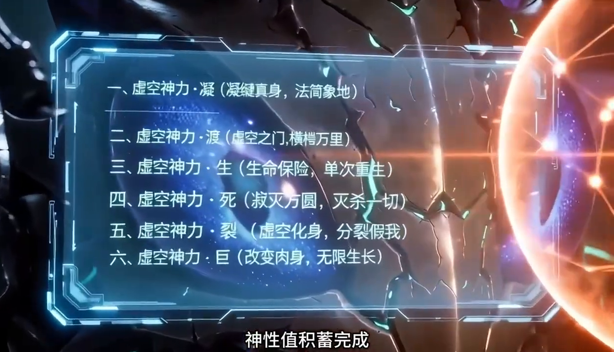

The screen presents six routes. Liang selects the first, and the choice is described as irreversible. The table translates their functions rather than treating every displayed option as an ability he possesses.

| Route | Offered function | Selection |
|---|---|---|
| Void Divinity: Condensation | Condense a true body and gain Heaven-and-Earth Manifestation. | **Chosen.** Strengthening the body supports his preferred direct combat. |
| Void Divinity: Crossing | A Void Gate for very long-distance traversal. | Not chosen. |
| Void Divinity: Life | A life-preserving opportunity for a single rebirth. | Not chosen by Liang at this selection. Later companions' survival powers must be considered separately. |
| Void Divinity: Death | An annihilating effect over the surrounding area. | Not chosen. |
| Void Divinity: Division | Void manifestations or divided substitute selves. | Not chosen. Muyu's own Fission is a different character's power. |
| Void Divinity: Giant | Alter the flesh for continuing bodily growth. | Not chosen. This is distinct from the manifestation granted by the first route. |

## Season 4: Floating Island, Divinity, and the Heavenly Gate

### 1. The tribute demand becomes an interrogation

A brief return to Dazhuang's family life precedes the confrontation at Central Island. Li Yan arrives with Sea-fist Shrimp, claiming authority from Muyu and demanding 180 jin of Ancient-Race Flesh every day. Since the island's daily receipts are only a little above two hundred jin, Dashui recognizes the demand as confiscation disguised as tribute.

Liang Cheng initially agrees, lowering the visitors' guard before attacking. Death's Shroud and his burning scythes turn the supposed collection visit into a slaughter. He keeps Li Yan alive for information. When frightened island leaders urge him to release the captive, Liang Cheng says they must personally supply the future tribute without touching his or Dashui's shares. Their preference for appeasement immediately disappears, and they help force Li Yan to answer.

The interrogation establishes that Muyu has not yet passed beyond Ultimate Form. It also explains the island's resource: a hollow, pale Ancient-Race bone about thirty meters long absorbs energy and regrows flesh. If allowed to continue, it develops skin, ringlike markings, and a flattened clawlike end, accompanied by an intimidating presence. Muyu repeatedly removes the new flesh instead of allowing that process to finish. Two other powerful defenders serve him: the Giant-clawed Crab King and a giant bloodsucking mosquito.

### 2. Muyu's trap and the invented tribal chiefs

Muyu knows that the Eagle King and Li Yan used his name to seek private gain. He forbids further seizure of flesh after legitimate trades, but Liang Cheng's growth concerns him for a different reason. He recalls the mantis defeating the Tricolor Water Dragon at Ultimate Early Stage and then rapidly reaching Middle and High Stage. Unable to abandon the Ancient-Race remains, Muyu needs to draw him onto Floating Island.

He announces an eight-hundredth-birthday celebration. Every attending tribal chief may receive one hundred jin of flesh, while Liang Cheng is offered ten thousand. Liang Cheng identifies the exceptional invitation as bait. He and Dashui stay away, but he appoints more than a hundred temporary chiefs, inventing new tribes from differences such as unusual feathers or missing limbs. Each receives a stone identity token and goes to claim the public reward.

Muyu honors the offer because breaking it would damage the exchange's reputation. Back at Central Island, Dashui collects sixty percent from the beneficiaries despite Liang Cheng's earlier promise not to levy their gifts. Liang Cheng performs a brief show of disapproval, accepts the supposedly voluntary contribution, and dissolves the temporary tribes. Consuming his share grants 17.368 billion energy points and sixty-one Divinity Points.

### 3. The Nine-Star Alignment and a struggle over supply

Dashui notices nine stars approaching alignment and recalls his people's ancient promise that gods will descend, open a heavenly gate, and offer ascension. Liang Cheng proposes a darker interpretation: their world could be a breeding ground, with the gods arriving when its creatures are ready to be harvested. This remains his suspicion, not an established explanation of the world's origin.

Meanwhile, Floating Island cuts Central Island's exchange return to one third of its former level. An appeal would bring Liang Cheng into Muyu's trap. A simple boycott would also fail: Central Island supplies about sixty percent of the trade, leaving Muyu other customers while Liang Cheng's followers lose all access to flesh.

Liang Cheng therefore seeks control of the remaining supply. The Quickfish rebuild their intelligence network; he and Dashui intercept caravans in separate areas, while the Sky-swallowing Rats supplement the crabs' collection work. Cores are accumulated at Central Island instead of being exchanged. His target is control of eight or nine tenths of the available supply, depriving the Ancient-Race remains of their feedstock. He warns defeated traders to stop visiting Floating Island. This blockade threatens Muyu much more directly than the previous toll-taking operation.

### 4. Defeating the two deputy rulers

Muyu responds to Liang Cheng and Dashui operating separately by sending the Giant-clawed Crab King and the giant mosquito against the mantis. Their ambush attacks from different directions. Liang Cheng disables the mosquito with one strike, leaving the crab to fight without its intended partner.

The crab challenges him to enter the sea and contest its claws directly. Liang Cheng instead gains height, creates the expectation of a descending attack, and strikes a vulnerable area. Only after weakening it does he accept a direct exchange. The crab is killed, while the mosquito remains available for interrogation.

The captive claims Liang Cheng might have an even chance against Muyu and warns that Muyu could attain divinity within a year. Liang Cheng recognizes these arguments as another attempt to draw him onto Floating Island. Under pressure, the mosquito admits that its instructions were to lure him there if the assassination failed.

With both deputies lost, Muyu temporarily concedes the economic dispute. He promotes the Eagle King and sends him to announce restored trading terms and repayment of the withheld flesh. Liang Cheng recognizes the messenger's involvement in the original extortion. The eagle's attempt to deny his identity fails, and Liang Cheng kills him. He accepts that Muyu is ready to negotiate, but does not consider restoration of the old price sufficient compensation.

### 5. Negotiating a better exchange

Liang Cheng sends three bird representatives to bargain: a seabird, a fire turkey, and a One-legged Crane. One highest-grade core previously purchased ten jin of flesh; his minimum acceptable new rate is twenty. He offers the negotiators a commission on anything obtained above that floor, giving them a personal reason to resist intimidation.

The delegation escalates its opening demand from fifty to eighty and then two hundred jin per core. Muyu objects that the last figure exceeds what a core can produce. When he tries to stop them leaving, they point out that killing the delegates would prolong the blockade and threaten the remains themselves. Bargaining finally settles at thirty jin, three times the original rate. Liang Cheng rewards each delegate with an additional fixed allowance of ten jin per day.

The increased flow gives his organization several hundred jin daily and accelerates his evolution. He still refuses an immediate attack on Muyu: an even chance of victory is inadequate when continued growth offers a safer prospect. He then reaches **Ultimate Form, Superior Stage**. The status readout lists Absolute Devouring, Divine Body, Sovereign Insect Domain, Extreme Speed, and Calamity Venom; this does not establish that each talent is newly acquired at that moment.

### 6. Old companions reach the sea

Dazhuang, Scarlet, and their queen activate the old teleportation formation and arrive on the volcanic island associated with Liang Cheng's earlier journey. They have left the children with the elders and hope to find him, obtain better resources, and establish a future base for their people.

The island's spiny insects are effective hunters at sea but poor fighters on land. The newcomers exploit that limitation to obtain fish and discover that the marine prey contains valuable Energy Cores. They also learn that Liang Cheng has already moved on.

Meanwhile, Liang Cheng advances again and reaches the peak of Ultimate Form. His progression display changes from Flesh Points to Divinity Points, with a ten-thousand-point requirement for the next major breakthrough.

Datou finds the three visitors during a nostalgic return to the island and reports to Liang Cheng. Liang Cheng sends Dashui to collect them, with Datou as guide and five hundred jin of flesh for the journey. At the same time, Floating Island abruptly ends all exchanges and expels its residents. Reports suggest that Muyu has stopped eating, appears partly paralyzed, and has prohibited anyone from returning for three years.

Liang Cheng suspects a staged breakthrough designed to make Muyu look vulnerable. Nevertheless, he cannot obtain Divinity Points through the exchange while it is closed, nor can he safely wait for his enemy to grow stronger. He decides to investigate in person.

### 7. The first battle with Muyu

The apparent retreat is indeed a trap. Muyu expects to kill Liang Cheng on the island, only to discover that the mantis has already reached the peak of Ultimate Form. Liang Cheng, in turn, finds an opponent with eight talents and a divine survival ability, developed across a life of approximately thirteen hundred years.

Muyu's eight arms initially overpower him. Their compression is so tight that Liang Cheng cannot spread void power around his entire body, preventing teleportation. This is an actual failure under restraint, unlike the false inability to teleport that he used to deceive the Tricolor Water Dragon. He describes the exchange as his worst setback since entering this world.

He then activates Death's Shroud and commits to its five-minute combat window. A void-based field slows Muyu, while Liang Cheng's speed leaves persistent afterimages and allows repeated attacks. Muyu survives the destruction of his large body through Fission: a small octopus formed through absorbed core energy attempts to hide among the remains, uses a falling stone as a distraction, and escapes.

Liang Cheng wins possession of Floating Island, but Muyu is not yet permanently dead. The followers who celebrate over the ruined octopus body do not know the full outcome. Liang Cheng understands that the escaped creature may return, while the fugitive later admits that it retains only half its former strength.

### 8. Controlling the resource and confronting an infection

Liang Cheng installs his bird representatives as Floating Island's administrative core and rewards participating chiefs with fifty jin of flesh per day. Control of the producer changes his pricing policy: ordinary traders again receive the old ten-jin return, rather than the thirty-jin rate he negotiated when he was the buyer. He reserves the larger share of production for his own organization.

Dashui arrives with the three mantises. Their former queen has relinquished her position and introduces herself as Feiyan, with the childhood name Xiaofen. Liang Cheng gives them access to Ancient-Race Flesh and orders Datou to attract more trading groups. With the supply secured, he accumulates enough divinity to prepare for seclusion, leaving Dashui under strict orders to protect the island without departing.

Before leaving, he learns that Dazhuang's growth is abnormal. After reaching Advanced Form, Dazhuang consumes enormous quantities of flesh and immediately enters another sleep to advance toward Super Form. He also has an extreme fear of seawater. Scarlet is developing the same fear.

Liang Cheng uses seawater to expose Scarlet's parasite, but cannot safely kill it: host and parasite are linked, so destroying the creature would also kill her. Its emergence also disrupts her memory. Feiyan may be infected as well. With no immediate cure and his own advancement ready, Liang Cheng tells them to avoid the sea and await his return.

### 9. Choosing a divine body

Liang Cheng finds an ancient, exceptionally hard carcass near the Sea of Death and uses it as a secluded refuge. His entry into the divine realm requires an irreversible choice among six evolutionary paths.

He rejects an enlarged teleportation option as redundant, an immense permanent growth route as making him an obvious target, and a high-output option with poor endurance. Other choices involve unacceptable risk or copies with only thirty percent of his strength. He selects True-Body Condensation, which strengthens him broadly and includes Heaven-and-Earth Manifestation, a power that can enlarge his combat presence when required.

During the long sleep, the others continue to change. Dazhuang learns about the parasite after awakening; Scarlet prepares for another advancement, and Feiyan develops symptoms. Dashui grows so large from the island's food that he can no longer comfortably leave the cavern, yet remains at his assigned post because damaging the remains or abandoning them would threaten everything Liang Cheng has entrusted to him.

Liang Cheng finally emerges as a Void Deity at the early stage of the Initial Divine Realm. His body has condensed to roughly two meters, with a slender purple form. The former skill list no longer appears as before, but his talents still include water, fire, wind, Concealment, and Void Control. He observes that his ordinary movements now exceed the strength of his previous all-out attacks.

### 10. A second divine advancement and a delayed return

The ancient shell that Liang Cheng could previously barely scratch can now be cut with half his strength. Eating it supplies enough Divinity Experience for him to advance to the middle stage of the Initial Divine Realm.

He then explores beyond the Sea of Death in search of further growth. Ordinary Ultimate Form creatures no longer provide the divinity he needs. Finding a concentration of the ancient Kun creatures might help, but the world is vast and his search does not produce a better source. Returning to Floating Island remains the reliable alternative.

Only then does he reckon with the time that has passed: the long advancement and subsequent exploration have kept him away for more than three years. Dazhuang has reached an externally impressive but compromised Ultimate state and is still trying to delay the parasite's final development.

Liang Cheng's small body causes a guard to mistake him for an insignificant visitor. He demonstrates Heaven-and-Earth Manifestation, appearing more than three hundred meters tall with enormous scythes, before resuming his compact size. Dazhuang cannot damage him even when invited to strike. His return restores hope, but he still has no simple method of removing the parasites safely.

### 11. A narrow rescue plan and Muyu's final defeat

Liang Cheng recalls that Muyu obtained a survival power while approaching divinity. He tells the infected mantises to choose a life-preserving or rebirth ability if such an option becomes available during their own breakthrough. It may allow him to destroy the parasite without permanently losing the host. He cannot promise that all three will receive a suitable choice, and delaying forever will not prevent the crisis.

Meanwhile, Muyu completes his own divine advancement and returns to reclaim the Ancient-Race remains. He hopes Liang Cheng is still vulnerable in seclusion. Seeing only a two-meter mantis in the cavern, he mistakes the changed body for weakness and attacks.

The anticipated clash between divine opponents is overwhelmingly one-sided. Liang Cheng kills and consumes Muyu so quickly that Dashui is astonished by the lack of resistance. Liang Cheng values the meal at roughly one hundred days of ordinary energy intake. This ends the threat from the octopus that escaped the earlier battle.

Dashui also reports that the nine stars are close to alignment, perhaps two years away. Liang Cheng plans to leave himself time to hide before the predicted descent of the gods, rather than assuming that superior strength makes the event safe.

### 12. The parasites mature, and Scarlet is lost

Dazhuang's parasite reaches maturity and emerges as a long purple Parasitic Demon capable of speaking through transmitted thoughts. It intends to consume the host that has sustained its growth. Dazhuang's survival mechanism gives him the opening Liang Cheng needs to intervene.

The demon turns its aggression against Liang Cheng. He meets it with his transformed power, cuts the elongated creature into separated sections, and devours it. Dazhuang survives, but his strength falls back to a weak Early Stage of Ultimate Form. Seeing how much Liang Cheng gains from the parasite, he suspects that his leader deliberately allowed it to grow. Liang Cheng denies this and reiterates the survival constraint: forced removal would have killed the host, while the divine breakthrough offered a chance of survival.

The same danger remains for Scarlet and Feiyan. Their chances depend on whether they can obtain the necessary rebirth power when their parasites emerge. Feiyan survives; Scarlet does not.

Dazhuang does not hold Liang Cheng responsible for the infection or claim that earlier forced removal would certainly have saved her. He recognizes that he and Feiyan would otherwise have had no chance. His grief centers on being powerless when Scarlet needed help. The parasite crisis therefore ends with two survivors and a permanent loss, not a complete rescue of the group.

### 13. A dangerous offer to starving mantises

Liang Cheng brings in other starving mantises and offers abundant Ancient-Race nourishment. He also tells them the danger plainly: if they carry Parasitic Demons, enough energy may awaken the creatures and kill their hosts. Those who decline can be transported back.

The mantises choose to stay. Their alternative appears to be continued starvation, so they accept the chance to grow even at the risk of dying. Four individuals show no corresponding movement in their abdomens after eating. Liang Cheng suggests that prolonged hunger may already have starved their parasites before killing the hosts.

This observation introduces a possible explanation for those four survivors. It does not establish a reliable or harmless cure for every infected mantis. The choice also shows the unequal conditions surrounding Liang Cheng's resource monopoly: access to food creates an opportunity, but his weaker relatives must accept risks he can largely overcome himself.

### 14. The Heavenly Gate reveals another world

The Nine-Star Alignment finally occurs. An immense ancient divine hand and a towering mountain confirm that the old legend describes a real event. Creatures from land and sea gather to climb toward the Heavenly Gate, with weaker or unlucky travelers falling during the ascent.

Dazhuang rides the fire turkey to investigate. At the summit, the apparently watery barrier behaves as a teleportation formation. Onlookers interpret it as a gift leading to a rich new realm. Images of small, apparently defenseless descendants of the gods encourage the belief that crossing will provide limitless prey and rapid evolution.

Dazhuang recognizes the figures as humans. Their lack of claws, fangs, or stingers does not mean they are harmless: their intelligence and weapons can outweigh the visitors' natural advantages. He also warns that the passage is one-way. He persuades the impatient turkey to return instead of rushing through, drawing on what Liang Cheng has previously taught him about humanity.

Liang Cheng has meanwhile hidden away for five months to avoid the celestial event. After emerging, he questions a snake about the new mountain and then observes the gate himself. Returning to his followers, he confirms that the destination is a human world and that its inhabitants may be far more dangerous than they appear.

### 15. Choosing to cross, after removing the alternative

Despite the danger, Liang Cheng decides to migrate. The familiar world offers increasingly poor prospects for further divine growth. Some followers, particularly the Sky-swallowing Rats, prefer to remain safely at Floating Island and continue eating Ancient-Race Flesh.

Liang Cheng says they may choose freely, then consumes the Ancient-Race remains. This removes the permanent food source that makes staying attractive. The rats reverse their decision and agree to follow him. The sequence matters: the supply did not simply run out on its own, and their consent follows his deliberate removal of their preferred alternative.

Other companions pledge to join. He also gives the recently recruited mantises a choice between accompanying him and returning to Central Island, while making clear that Floating Island will no longer provide their former food. They elect to go. The group receives three days to prepare, with instructions against bringing entire families.

Dashui's immense size and lack of wings make the mountain an obstacle, so Liang Cheng supplies the speed and transport needed to bring him up. At the gate, Liang Cheng volunteers to enter first and tells the others to follow. The season ends with the party crossing the teleportation barrier; their battles and living conditions in the human world have not yet been shown.

## Illustrated form atlas

### 1. Opening Ultimate body: continuity with Season 3

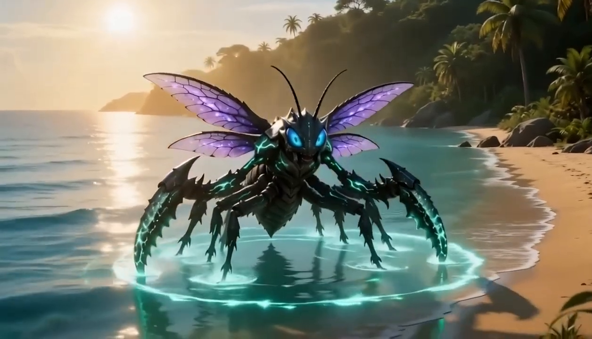

**State:** Ultimate Middle at the previous season's ending, with High Stage subsequently reported by Muyu during this season's early strategy discussion.

**Appearance:** Black plated armor, bright cyan seams, glowing blue eyes, four prominent violet wing blades in the selected shot, and heavy scythes with large serrations. The pointed abdomen and spiked limb armor continue the established Void Mantis design. The water and cyan light around the feet are scene effects rather than a separate aquatic form.

**Evidence boundary:** This image records the opening body. The later High-stage identification comes from dialogue, so a separate High-stage transformation image is not invented.

### 2. Ultimate Form, Superior Stage

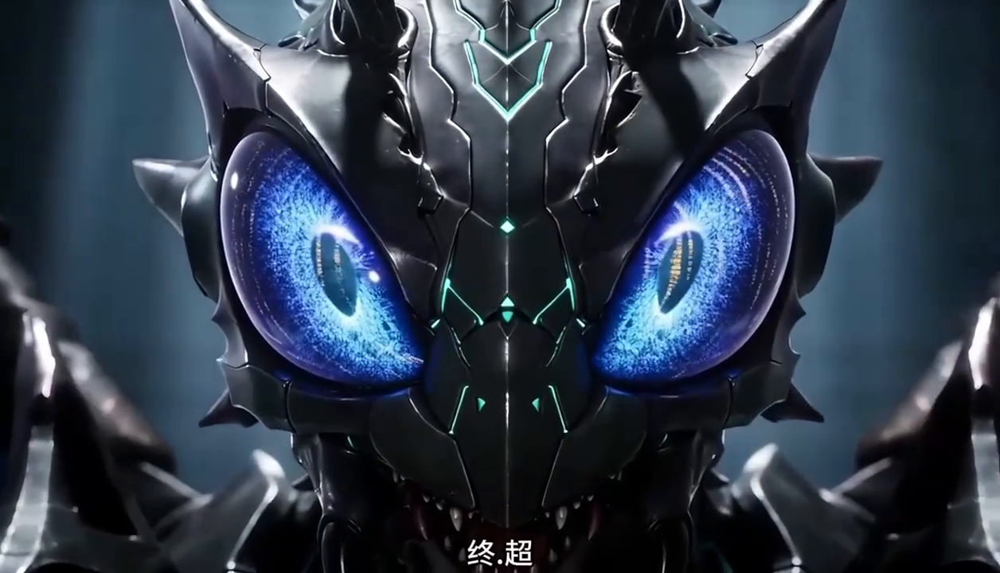

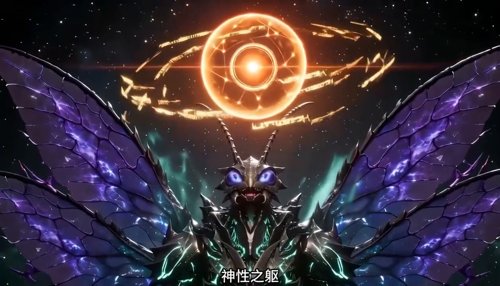

**Position:** After the negotiated improvement in the flesh exchange. The stage is labeled Chao in the original scene and rendered **Superior Stage** in this reference.

**Appearance:** The dark, broad armored build remains, with intense blue-violet eyes, cyan luminous channels, a spiked head and shoulders, broad translucent violet wings, and large hooked scythes. Orange rings and the floating orange sphere belong to the promotion presentation. They are not treated as permanently attached anatomy.

**Readout:** The scene lists Absolute Devouring, Divine Body, Sovereign Insect Domain, Extreme Speed, and Calamity Venom. Listing these names establishes their association with the readout; it does not independently prove that every one was first acquired at this exact moment or specify unshown numerical effects.

**Name uncertainty:** The subtitle track includes a species designation ending in King Insect, but its complete written name is not securely recoverable from the reviewed frames. The atlas therefore identifies this entry by its confirmed stage rather than supplying an invented complete title. The talent name Divine Body also does not mean Liang has already entered the divine realm.

### 3. Ultimate Form, Peak Stage

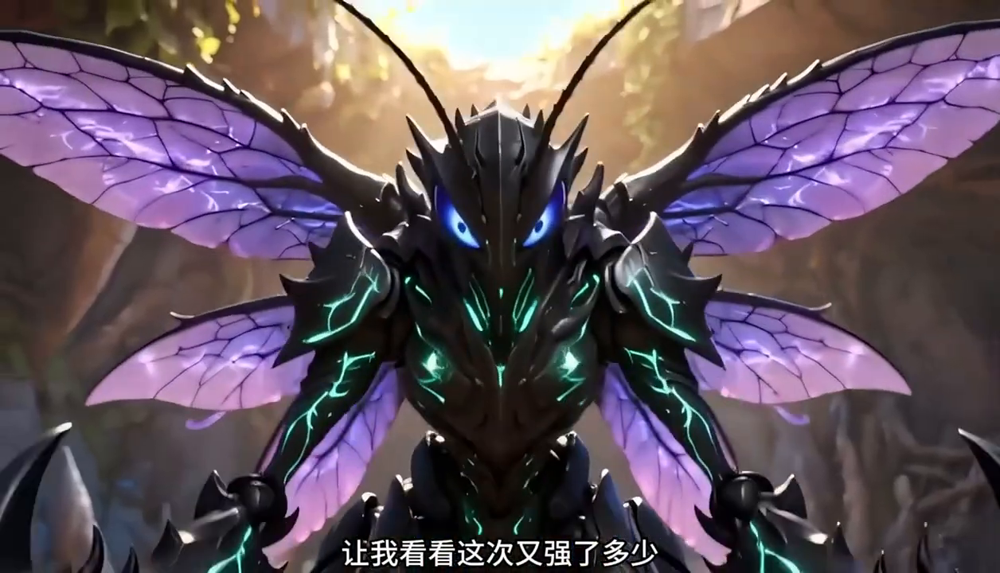

**Position:** The next advancement, before the first personal fight with Muyu. Liang's account and the subsequent battle establish that he has reached the peak of Ultimate Form.

**Appearance:** The recognizable black armor, cyan channels, vivid blue eyes, and violet wings continue. The selected view shows broad shoulder protection, dense chest armor, and a jagged crown. It supports continuity of the design rather than proof of an entirely different species.

**Progression change:** The next major advance depends on Divinity Points, with a stated target of 10,000. Liang expects to accumulate what remains over roughly eighty days at his current rate. A separate half-divine body is not shown as a compulsory protagonist step.

**Combat limit:** Muyu can squeeze him so tightly that void power cannot surround his whole body, preventing teleportation. Liang must escape the disadvantage through his combat burst, field effect, and speed. This is a demonstrated constraint in this battle, unlike his deliberate false claims during the dragon fight.

### 4. Void Deity: Initial Divine Realm, Early Stage

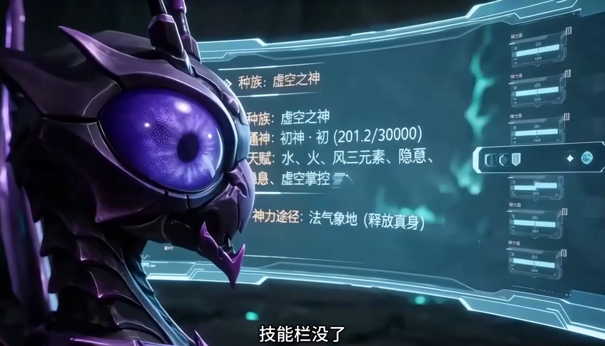

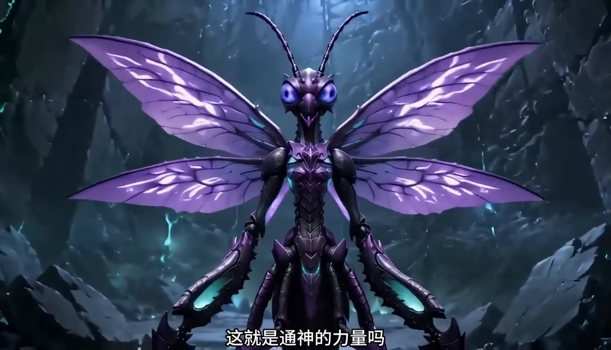

**Position:** Completion of the long retreat after selecting True-Body Condensation.

**Appearance:** The ordinary body condenses to about two meters and becomes markedly more slender. The neck and torso are elongated, purple and dark-violet plates replace much of the earlier bulky silhouette, and four pale-violet veined wings spread broadly from the back. The antennae remain long, the eyes appear violet to blue, and the paired scythes are narrower relative to the body, with cyan-lit inner surfaces and toothed cutting edges. Some cyan accents remain on the chest and lower body.

**Strength:** The smaller frame is a concentration of power. Liang says his basic actions now exceed his previous full-power attacks, and he can cut the ancient shell that resisted him before.

**Interface change:** The old skill section disappears from the display, while the panel still lists water, fire, wind, concealment, and void control among the talents. One intervening entry is partly obscured. This is enough to reject the claim that all earlier powers were erased, but not enough to assign an exact fate to every former named move.

**Chosen divine ability:** Heaven-and-Earth Manifestation belongs to the Condensation route. The other five route options remain unselected.

### 5. Initial Divine Realm, Middle Stage

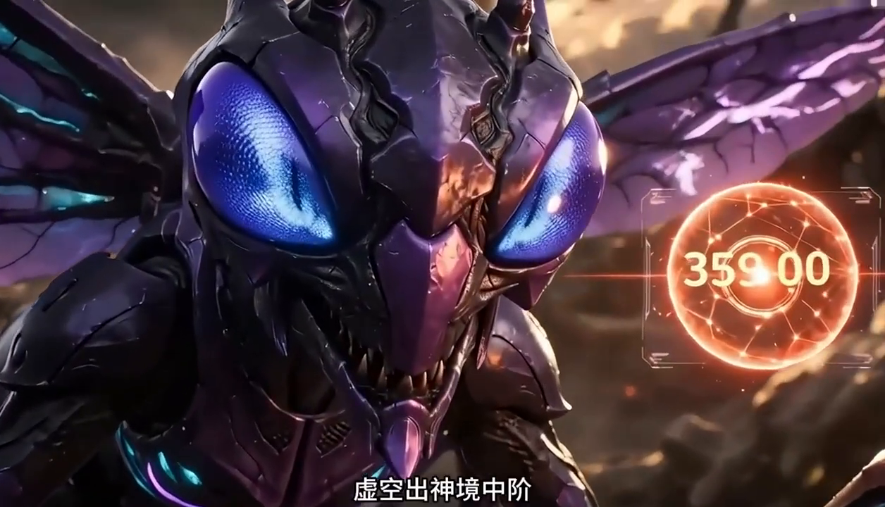

**Position:** Immediately after Liang eats the ancient armored remains around his retreat.

**Appearance:** The divine purple-body identity persists. The selected close-up emphasizes large blue-violet eyes, dark violet facial plates, cyan traces, and purple wings. Differences in the face's proportions between shots do not establish another named body.

**Growth mechanism:** The remains yield Divinity Experience where ordinary Ultimate creatures later prove insufficient. Eating this resource causes the next stage promotion.

**Numerical evidence:** The announcement reports 35,000 points while this nearby display reads 35,900; the earlier panel also contains a different denominator. These inconsistent presentation details are retained as observations rather than reconciled into a fabricated precise cost or a fixed per-carcass reward. The Middle-stage advancement itself is clear.

### 6. Heaven-and-Earth Manifestation

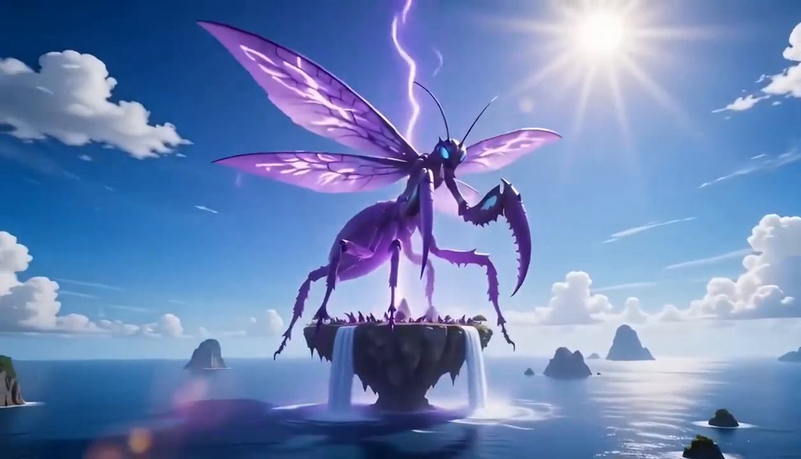

**Classification:** An expanded expression of the chosen divine body, not a newly acquired evolutionary realm.

**Appearance:** The slender mantis design is enlarged to dominate the island: long legs, a segmented abdomen, huge curved scythes, and sweeping violet wings. Its outline remains related to the compact Void Deity rather than becoming a separate beast.

**Scale:** Witnesses describe Liang as more than three hundred meters tall and estimate the scythes at roughly five hundred meters. These are dialogue descriptions, not a measured model sheet. The illustration communicates the intended enormous scale without requiring every rendered proportion to agree with those estimates.

**Function:** The display makes his transformed identity undeniable to the inhabitants who dismissed his two-meter body. He can resume the compact form afterward. The unselected Giant route offered continuing bodily growth and should not be merged with this manifestation ability.

### 7. Parasitic Demon: a separate creature

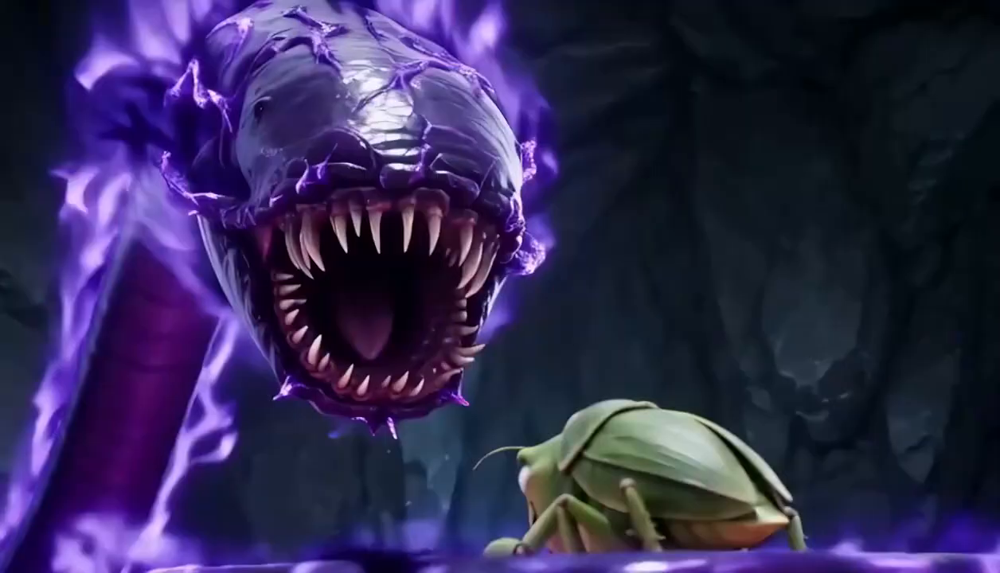

**Classification:** An enemy developing inside a host. It is not one of Liang Cheng's forms.

**Appearance:** A long purple wormlike body, a ridged armored head, a wide circular mouth lined with pointed teeth, and a violet aura. The emerging creature is much larger than the ordinary mantis body beside it.

**Mechanism:** Host growth feeds the parasite's maturation. Fear of seawater, unusually rapid advancement, and extreme appetite expose the problem. Seawater can reveal or draw out the creature, but removing it does not by itself offer a safe cure because host and parasite are linked.

**Resolution:** Liang relies on the host having a suitable survival or rebirth power, then cuts the emerged demon into sections and consumes it. Dazhuang and Feiyan survive; Scarlet dies. The suspected absence of living parasites in four long-starved mantises remains an observation and hypothesis, not a universal treatment rule.

## Abilities and character outcomes to keep distinct

| Item | Owner or status | Reference distinction |
|---|---|---|
| Absolute Devouring, Divine Body, Sovereign Insect Domain, Extreme Speed, Calamity Venom | Liang's Superior-stage readout | No unsupported multiplier or poison formula is added. |
| Death's Shroud | Liang, used in the first Muyu battle | The five-minute combat window remains significant before divinity. |
| Void field used against Muyu | Liang | The reviewed dialogue does not conclusively establish that its name is an exact synonym for Sovereign Insect Domain. |
| Fission | Muyu | Enables escape from the first defeat. Liang does not acquire it merely because it appears on screen. |
| Heaven-and-Earth Manifestation | Liang's selected divine route | Permits the gigantic display while his normal divine body remains small. |
| Survival or rebirth abilities | Infected companions' possible choices | Their availability determines who can survive the parasite's emergence. They are not all automatically granted Liang's chosen route. |
| Dazhuang and Feiyan | Survive the parasite crisis | Dazhuang explicitly drops back to a weakened Ultimate Early state. This is not Liang's rank. |
| Scarlet | Dies during the parasite crisis | Her death remains part of the final outcome. |
| Muyu | Escapes the first battle; dies after returning as a divine opponent | Destruction of his first large body is not his final death. |
| Giant-clawed Crab King | Muyu's deputy, killed in the blockade conflict | A different individual from You Qian, the Crab King appointed by Liang in Season 3. |

## Departure state

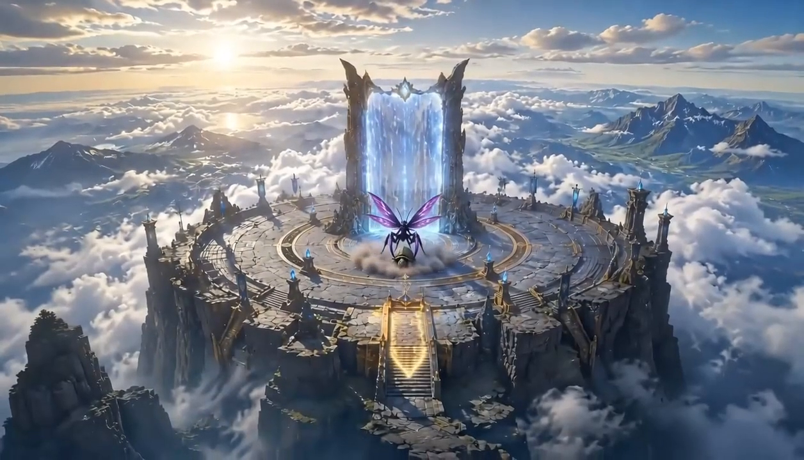

Liang reaches the gate as the divine leader of the surviving group. He has removed the Ancient-Race remains from Floating Island by consuming them, ending the food supply that some followers hoped to retain. Their migration follows that decision. The party enters the one-way passage, and the reviewed season stops before depicting its life or battles in the human world.

Feiyan is the former Mantis Queen; Xiaofen is her childhood name. Scarlet is Dazhuang's partner. The reference retains these identities across the reunion and parasite events. The infection's original route is not established: Ancient-Race Flesh accelerates growth, but the earlier symptoms prevent treating its first consumption as the proven moment of infection.
