# Liang Cheng: Seasons 2–4 Complete Reference

Detailed chronological story, evolution milestones, abilities, and original illustrated form atlases. This file combines the season-specific references below. Keep the accompanying `images` directory beside it to display all 21 original stills.

## Liang Cheng: Seasons 2 and 3

Detailed chronological story, evolution record, and illustrated form atlas.

This reference follows the Liang Cheng adaptation. Season 2 covers the mantis capital, the Nine Domains Sacred Land, and the first island campaign. Season 3 continues the expedition to the crab reefs and ends with the Eagle King's expedition toward Central Island. The account follows the reviewed season compilations rather than assigning unverified individual episode numbers. It paraphrases events and explains their causes and consequences.

The illustrations are original video stills, with their existing captions and graphics intact. The atlas distinguishes confirmed rank changes from changes in lighting, battle effects, and equipment-like elemental attachments. Images are embedded from the accompanying `images` directory.

### Reading the ranks

| Term | Meaning in this reference |
|---|---|
| Lower Tier / Second Tier | Earlier evolutionary tiers, with numbered grades. A Grade 9 enemy or core does not establish Liang Cheng's own grade. |
| Advanced Form / Super Form / Ultimate Form | Successively higher categories of evolved life. These are not translations of Grade 1, Grade 2, and Grade 3. |
| Early / Middle / High / Peak Stage | Subdivisions encountered or referenced in these seasons. A subdivision is recorded only when the reviewed material supports it. |
| Form name | A named body such as Void Harvester or Void Mantis. An increase within a form does not necessarily introduce a new name or silhouette. |
| Energy cores | Food, stored energy, and currency. Their quality grades describe the resource. |
| Experience / Flesh Points | Growth values reported at different points in the story. Displayed amounts are retained in context rather than forced into an invented universal conversion. |
| Divinity Points | A separate resource associated with later advancement. Acquiring it is not itself a divine transformation. |

The confirmed progression across these seasons is:

**Second Tier, Grade 8 → Advanced Form: Void Harvester → Super Form, Middle Stage → Super Form, High Stage → further Super Form growth → Ultimate Form, Early Stage: Void Mantis → Ultimate Form, Middle Stage.**

The transition into Super Form takes place across the end of Season 2 and the opening of Season 3. A separate Grade 9 transformation, the precise intermediate Super Peak milestone, and a new name for the Super Form are not securely established in the reviewed scenes.

### Evolution milestones

| Position in the story | Confirmed state | What produces the change or demonstrates it |
|---|---|---|
| S2: arrival at the capital | Second Tier, Grade 8 | Scarlet and the guards identify the rank. Consuming the treasury's Grade 9 core does not immediately change this identification. |
| S2: clearing the Sacred Land | Still Grade 8 | Liang defeats Grade 9 rulers through superior combat ability. Opponents continue identifying him as Grade 8. |
| S2: emergence during the centipede invasion | Advanced Form, Void Harvester | The captured cores support a half-month retreat. He explicitly emerges beyond the Grade 9 breakthrough expected by the other mantises. |
| S2: island campaign | Advanced Form | The giant turtle and Super Form Island Lord belong to higher categories. Their ranks must not be transferred to Liang. |
| S2 ending / S3 opening | Super Form; Middle Stage confirmed in S3 | A two-month retreat precedes the departure for the reefs. Dashui later explicitly calls him Super Middle. The post-retreat body has black armor, violet eyes, and violet markings. |
| S3: jellyfish caravan | Super Form, High Stage | The jellyfish leader identifies his stage during the fight. The opposing leader is Ultimate Form. |
| S3: expanding trade raids | Further Super Form growth | Large flesh rewards support additional progress. One stage caption is inconsistent, so no exact Peak-stage promotion scene is claimed. |
| S3: secluded island retreat | Ultimate Form, Early Stage; Void Mantis | The original title card identifies the form and stage. Liang also calls the power Void Lord. These labels refer to the same transformation. |
| S3: eating the dragon hatchlings | Same Ultimate body, three new proficiencies | Fire, Wind, and Water Proficiency are acquired in that order. Initial output is weak and requires practice. |
| S3: defeating the Tricolor Water Dragon | Same Ultimate body, three elemental sources | Fire and Water Sources are swallowed during the battle; the Wind Source is surrendered afterward. They substantially improve elemental use. |
| S3: organizing Central Island | Elemental attachments completed | Wind is attached to the wings, fire to the left scythe, and water to the right scythe. Anatomical left and right are intended. |
| S3: consuming the island's accumulated tribute | Ultimate Form, Middle Stage | The original title card confirms the stage. The Void Mantis body remains recognizable, and no separate new form name is supplied. |

### Season 2: The Sacred Land and the Islands

#### 1. A Reward That Empties the Treasury
*00:00:00–00:13:58*

Liang Cheng travels to the mantis capital with Scarlet, still a Second Tier, Grade 8 warrior. The journey underlines a limitation that will follow him into the next part of his life: powerful fish control the rivers, and a mantis cannot safely pursue them underwater. Scarlet would prefer that he settle down with her, but Liang is interested in finding stronger prey and more energy cores.

At the capital, Scarlet reports his destruction of a beetle camp and two locust camps. Their Grade 8 casualties make his achievements difficult for the Mantis Queen to dismiss. Liang meets the Grand Elder, an aging Grade 9 whose body is becoming rigid, and hears about the Nine Domains Sacred Land. Its resources sustain the strongest warriors of nine competing insect factions. Even its ordinary feeding grounds are valuable, while an ancient secret may lie within its shifting central formations.

Liang turns the queen's offer of a reward into permission to feed inside the royal treasury. She specifically forbids him from touching a Grade 9 core inherited from an ancestor. His system allows him to ignore the usual limits on absorbing stronger cores, however, and he consumes the stored supplies across Grades 6 through 9. The queen is furious. The Grand Elder argues that such an investment could be repaid through future victories, and Liang is sent to the Sacred Land to make that promise real.

#### 2. The Campaign Against Eight Factions
*00:14:00–00:45:15*

The Sacred Land's outer territories are relatively stable, but its inner stone passages move and its core becomes accessible only once every eight days. The Grand Elder assigns Bai Hui to guide Liang. Bai Hui considers an attack on the beetles suicidal, particularly because mantis blades are supposedly ineffective against their armor. Liang forces him to cooperate and starts clearing the beetles' resource sites.

The beetle king has just reached Grade 9 and is planning an offensive against the mantises. Confident in both his new rank and his protective shell, he allows Liang three strikes before retaliating. Liang penetrates that protection and kills him. The king and eight Grade 8 generals fall, overturning the defenders' assumption that a Grade 8 mantis cannot threaten them. When the Grand Elder arrives expecting to rescue the raiders, the main battle is already over.

Liang continues into the neighboring territories. The Sky-shrouding Locusts have many Grade 8 fighters but no Grade 9 leader capable of checking him. The Golden-armored Longhorn Beetles possess a Grade 9 king whose antennae function as whips, but Liang's speed defeats that weapon's reach. Bai Hui, meanwhile, discovers that pursuing survivors is considerably harder for him than for his leader; Liang frees him when he becomes trapped and keeps him motivated with cores.

The Three-tailed Scorpions present a different problem: venomous tails, pincers, and dangerous close combat. Liang forces a captured beetle to lead him to their territory and then kills the captive. Against the scorpions, he turns one creature's own stinger against its body, establishing that its venom can harm its own species. Their defenses fail too. Fire-spitting Bugs and the remaining factions follow, ending with Camouflage Butterflies that field two Grade 9 fighters.

Within four days, all eight rival factions have lost their positions in the Sacred Land. Requests for occupation troops grow into a demand for ten thousand mantises. The queen reorganizes her forces and population around the captured resources, while Liang takes the accumulated cores into seclusion.

#### 3. The Grand Elder's Last Battle
*00:45:15–01:01:15*

The mantises assume that Liang is attempting to reach Grade 9. While he is absent, their victory attracts an enemy from beyond the grassland: an Advanced Form Hundred-legged Centipede searching for an ancient ruin. It extracts directions from survivors and kills an informant despite having obtained the information it wanted. The Sacred Land's turbulent approaches and difficult terrain cannot keep it out.

The invasion exposes the limits of the mantises' triumph. They have taken territory from peers within their own tier, but the centipede belongs to a stronger category of life. With the queen initially inside the intermittently accessible central area, evacuation becomes urgent. The Grand Elder stays behind to buy time.

He has held Grade 9 for seventeen years, and his habitual boasting has concealed a combat talent that consumes his remaining life. He activates it now. His aging Second Tier body cannot match the centipede's sustained strength, but he wounds the invader and delays its pursuit long enough to protect others. The cost is irreversible.

Liang emerges during the crisis as an **Advanced Form Void Harvester**. His new abilities include **Void Rending**, which triples his strength, and **Void Crossing**, which triples his speed, alongside Void Power. His system has also changed: lower-tier creatures can now provide energy, although the returns diminish. When the other mantises mistake his arrival for a mere Grade 9 breakthrough, he explains that his half-month retreat has carried him beyond that threshold. He reaches the Grand Elder in time to acknowledge his courage, but cannot prevent his death.

#### 4. Turning Thunderfire into Food
*01:01:15–01:04:10*

Liang attacks the centipede and cripples its legs, taking away the mobility that helped it penetrate the Sacred Land. The enemy responds with Thunderfire, committing an energy core that contains nine-tenths of its power. Instead of being overwhelmed by the attack, Liang consumes the core. The weapon becomes food, and the centipede loses the strength on which its arrogance depended.

Liang questions the defeated invader about the ancient ruins. It knows that opening them could bring enormous rewards, but cannot explain how to do so. He then leaves the weakened creature to the mantises, who kill it in revenge for the Grand Elder.

The elder's sacrifice also changes Liang's relationship with the survivors. His depleted core is no longer a useful meal, and Liang tells the queen to keep it as a memorial. She offers him the throne, believing his power could lead the species into a new era. He refuses. Territory and royal obligations would tie him to a place whose strongest resources he has already exhausted. He wants to solve the Sacred Land's mystery and then seek stronger life elsewhere.

#### 5. Dazhuang and the Door to Another World
*01:04:10–01:10:45*

The central formation contains a mechanism that accepts a formation stone. Liang recognizes it as a teleportation array, although its destination remains unknown. Before using it, he investigates the coast. Small prey offer little progress against a target of two million experience, and his inability to swim keeps richer marine hunting grounds out of reach.

He also returns to the Peach Grove and finds Dazhuang enjoying a comfortable life. Dazhuang is astonished by the Void Harvester and admits that he has remained at Lower Tier Grade 9 while Liang has moved far beyond him. Comfort has undermined his determination to improve. He asks to leave, and Liang brings him to the mantis settlement, where the queen allows him to train.

Liang waits for the Sacred Land's core to open again, resists another attempt to persuade him to remain, and activates the array. It deposits him inside the crater of an island volcano. The transfer offers an escape from the grassland's limits, but also places him among creatures and resources he does not yet understand.

#### 6. A Predator Discovers Recurring Income
*01:10:45–01:25:00*

The island's food supply comes largely from the sea. Sea-fire Bugs catch Sea-fat Fish and accumulate their energy cores in caves. Liang attacks one group of six brothers and kills them, but learns that indiscriminate slaughter has drawbacks: flames can destroy valuable food, and other bugs can escape beneath the water where he cannot follow.

He starts calculating the difference between a single kill and a continuing supply. A living fishing group can produce fresh cores every day. Killing it yields a one-time reward; leaving it alive creates repeated opportunities to take its catch. Liang therefore shifts from exterminating the bugs to raiding their stores.

Concealment, nighttime attacks, and distractions make the arrangement effective. He enters caves while the inhabitants sleep, consumes their stocks, and withdraws before they can stop him. Datou gathers the threatened bugs into the Haila League, hoping numbers and organized protection will solve the problem. Instead, the concentration of food gives Liang a larger store to target. Drawing the guards away and slipping back inside proves more useful than fighting the entire group openly.

The bugs become unwilling suppliers rather than willing allies. Liang's continued dependence on their work gives him a reason to keep them alive, but he still enforces cooperation through threats. He also keeps testing the sea, frustrated that his powerful mantis body remains unsuitable for diving. When he spots a Thunder Eagle with lightning and Wind Power, he initially leaves it alone: regular core deliveries are already making a dangerous fight unnecessary.

#### 7. Protecting the Fishers from the Thunder Eagle
*01:25:00–01:31:45*

The eagle eventually attacks the Sea-fire Bugs, killing members of the group and threatening Datou. Liang intervenes. Protecting the bugs now protects a food supply on which his own growth depends, while the survivors gain a defender against a predator they cannot defeat themselves.

The eagle has eaten mantises before, but Liang is the first Advanced Form individual it has encountered. He detects its approach through the sound of its wings and damages a wing during the fighting. Rather than simply trading attacks until one side falls, he encourages the bird to depend on its lightning talent. He presents lightning as the answer to his apparent resilience, baiting the enemy into committing its special attack.

That decision exposes the eagle's energy core. Liang consumes it, repeating the principle that defeated the centipede: an enemy concentrates its strength into something his system can swallow. The weakened bird is then left to the bugs, who take revenge for their dead. Liang gains another rich source of energy and removes the threat to his regular suppliers.

#### 8. Migration and the Turtle's World
*01:31:45–01:41:20*

The island's volcano is expected to erupt within five days. The bugs explain that these eruptions periodically force them to migrate north to an archipelago. Liang needs their geographical knowledge, but they use their swimming ability to get ahead and deliberately leave him behind.

Exhausted by the journey, he lands on what appears to be a small island. Its surface carries armored barnacles. Their shells are difficult to penetrate, but their attachment points provide a weakness his blades can exploit. Removing them reveals that the entire island is the shell of a giant turtle.

The giant turtle, Dashui, is **Ultimate Form**, two major levels above Liang. Despite its enormous strength, it cannot reach the barnacles on its own back. Liang exchanges cleaning work for a ride, gaining food and transport from a problem that brute power alone cannot solve.

Their conversation expands his understanding of the world. The turtle is roughly a thousand years old and considers itself in its prime. It recalls seeing a juvenile Kun already at Ultimate Form, Peak Stage, illustrating how radically the potential of different species can vary. Beyond Ultimate Form, it believes, lies contact with divinity. Its people preserve a legend of nine stars aligning, gods descending, and the Heavenly Gate opening a path toward divine existence.

These possibilities remain distant. The immediate journey stalls when the turtle detours to visit a female and wants Liang to clean her shell as well. After several days of delay, he leaves and resumes his flight toward the islands.

#### 9. The Island Lord's Fatal Audience
*01:41:20–01:54:45*

Liang finds Datou's group under a new master. Flying Golden-haired Mice control the island, and their Super Form ruler demands heavy tribute. The Sea-fire Bugs must provide at least 120 cores a day; the ruler's nephew adds a personal surcharge. Escaping Liang has placed them under a predator whose demands are even harsher.

Datou tries to draw Liang into removing the Island Lord. Liang initially acts intimidated, but when the bugs cannot meet their quota he reveals that he intends to kill the ruler. He uses a core to secure an introduction and learns that the stockpiles support trading arrangements beyond the island.

At the audience, he poses as an admiring newcomer bearing an exceptional fish core. He claims it contains an image of the entire archipelago, appealing to the ruler's vanity and curiosity. The story gives him permission to approach. Once within reach, he launches a surprise attack and withdraws, refusing to offer the straightforward contest the stronger ruler demands.

The injured Island Lord becomes increasingly violent toward his own followers. One mouse consumes material carrying the ruler's blood and is killed for it; the others are ordered to stay out of the cave. Liang continues the attack while the ruler's own fear and anger isolate him. Outside, a mouse challenges Liang's ability to hurt it and is promptly killed. Soon the remaining followers discover that their ruler is dead as well.

Liang claims the cave and the title of Island Lord. He has defeated a Super Form opponent while still identified as Advanced Form, using deception and access to overcome the disadvantage in rank.

#### 10. A New Tribute System
*01:54:45–01:58:50*

Datou briefly imagines that the two predators have destroyed each other and left the bugs free. Learning that Liang has taken over ends that hope, but his new role proves more profitable than expected. Liang makes him responsible for managing the core stores.

The revised levy requires the mice to provide one hundred cores and ten Flying Demonfish each day. They welcome the terms because their previous ruler confiscated everything. Datou collects additional meat under Liang's authority, feeds his own group, and leaves the cores for his patron. Liang recognizes what he is doing and permits it: the arrangement gives the workers and administrator a benefit while maintaining the flow of energy he wants.

After Datou reports a collection of 3,465 cores, Liang prepares another retreat. He seals the cave and instructs the bugs to prevent interruptions or outside arrivals. The island's labor continues accumulating resources while he concentrates on his next transformation.

#### 11. The Debt and the Stolen Stockpile
*01:59:27–02:04:00*

The former Island Lord's outside dealings return in the form of Giant Crab collectors. Their emissary claims that the dead ruler owed the Crab King ten thousand energy cores. A change of ruler, he insists, does not erase the obligation. On learning that the island now holds thirty thousand cores, he declares the entire stockpile due as principal and interest and threatens to destroy the settlement if anything is missing.

Datou sends most of his followers away and remains with an assistant. He cannot defeat the hundreds of crabs that arrive, and a doomed defense would destroy both the witnesses and Liang's chance of finding the thieves. Instead, he pretends to cooperate. He asks where future collections should be delivered and learns of the crab base in a large reef field to the east.

His assistant mistakes this for betrayal. Datou explains the purpose: Liang has sealed his cave to attempt Super Form, and survivors with useful information can direct his retaliation once he returns. Dying beside the stores would accomplish less than preserving the route to the enemy. The stockpile is lost, but the means of pursuing it remain.

#### 12. Departure for the Reefs
*02:04:17–02:06:32*

Liang emerges with the dark, violet-eyed body carried into the next season and learns that he has spent two months inside the cave. The following sea expedition confirms him as Super Form, Middle Stage. Expecting a substantial reserve, he instead receives Datou's account of the crab raid. He immediately decides to visit the eastern reef field and requires Datou to guide him.

Datou tries to avoid the journey, but Liang's blades settle the argument. They set out with the stolen cores still unrecovered and the Crab King's strength untested. The season ends on that departure, carrying the island's resource conflict into the next expedition.

### Season 3: The Sea Trade and the Void Mantis

#### 1. A sea journey becomes a campaign against the giant crabs

Liang Cheng begins this stage of his journey at sea with Datou, a Sea-fire Bug whose enthusiasm for adventure is much weaker than his own. A gathering storm pushes them toward the water, where their different bodies make even basic travel awkward. They meet the giant turtle Dashui, an old acquaintance who knows the surrounding islands and their inhabitants. Dashui directs Liang Cheng toward reefs occupied by Silver-armored Giant Crabs. Their king has reached the Peak Stage of Super Form, while Liang Cheng is subsequently identified as being at the Middle Stage of that form.

Leaving Datou on Dashui's shell, Liang Cheng raids the reefs. He uses surprise to kill individual crabs and then demonstrates that the king's formidable claw cannot protect him. Rather than simply eating the defeated population, he takes control of it. He claims that the crabs owe him 880,000 Energy Cores for an earlier raid on islands he now controls; the crabs acknowledge taking only 30,000. The difference is part of his coercion, not an established accounting of the theft.

After killing resistance, Liang Cheng appoints You Qian as the new Crab King. He demands an initial payment of 30,000 cores, but the former king has already spent those cores at Floating Island. This missing payment introduces a resource more valuable to Liang Cheng than the crabs themselves: Ancient-Race Flesh.

#### 2. Floating Island and the value of Ancient-Race Flesh

Dashui explains that Ancient-Race remains can be nourished with Energy Cores to produce flesh that rapidly strengthens other creatures. Floating Island controls this exchange, under its ruler Muyu. Liang Cheng puts Datou in charge of supervising the crabs' collection effort and brings their accumulated cores to the island.

The exchange operates under strict protection. Powerful guards enforce a ban on private fighting within a radius of one hundred li, while a current carries visitors into the trading cavern. Liang Cheng's first delivery is counted as 23,424 lowest-grade Energy Cores. He exchanges them for Ancient-Race Flesh and distributes portions to Datou and the crabs as well as eating his own share. This reward makes the new hierarchy materially useful to his followers. His portion supplies more than twenty million experience points and also grants Divinity Points, whose eventual purpose he does not yet understand.

Liang Cheng recognizes that conquering Floating Island directly would be far more dangerous than exploiting its traffic. Instead, he plans to intercept trading parties outside the protected radius, seize their cores, and exchange those cores through the island's legitimate market. The crabs become scouts and collectors for this operation. They are also sent to bring Dashui into the enterprise, although Liang Cheng initially neglects to reserve the turtle a share of the proceeds.

#### 3. Defeating the jellyfish caravan

The first major target is a caravan of roughly one hundred jellyfish carrying thousands of mid-grade Energy Cores. Their bodies are dangerous in several ways: they possess strong defenses, poison, and an ability to impose paralysis. Their leader is an Ultimate Form creature, whereas Liang Cheng is described during the confrontation as a High Stage Super Form mantis.

Liang Cheng avoids opening with a direct assault on the strongest opponent. He first attacks a jellyfish that has fallen behind, testing the species and creating disorder within the group. Teleportation allows him to reposition, and moving beneath the water prevents the caravan from controlling the engagement in the way it expects. When the leader catches him with its body threads, he can still escape the restraint.

The leader's protective outer layer initially resists his blades. The fight nevertheless ends with the leader pierced and defeated, unable to cope with his ability to appear at unexpected positions. The victory demonstrates how mobility and selective engagement let him overcome a stronger form; it does not establish a newly named finishing technique.

The surviving operation yields a reported 2,965 cores, with a highest-grade core also singled out. Liang Cheng returns to Floating Island to exchange the haul. The guards notice the sudden improvement in the quality of his goods, but suspicion has not yet become an effective barrier to trade.

#### 4. Dashui joins, and water control becomes a weapon system

Dashui is angry that he received nothing from the first exchange. Liang Cheng repairs the relationship with twenty jin of Ancient-Race Flesh, and the turtle accepts him as the leader of their partnership. Dashui's enormous shell becomes the group's mobile base, accommodating the crabs and their supplies.

The alliance also acquires a new battlefield advantage. When fifty-one lizards attempt to drive the crabs away and claim the shell, Dashui kills them, leaving their cores for the group. Liang Cheng sees that the turtle's water control has much greater potential than its habitual use of gathering prey into its mouth. He proposes shaping water into tools and weapons: mantis scythes, fins, or grasping hands. The important change is how Dashui imagines and directs the ability, rather than the acquisition of a different talent.

Liang Cheng further distinguishes an impressive display from an efficient attack. Large water weapons can overpower weak opponents, but their success may merely reflect Dashui's superior level. Against a dangerous enemy, small, dense, concealed weapons and attacks timed to exploit distraction are more useful. His discussion of possible attacks on Floating Island's ruler is instruction and speculation. The group does not actually fight Muyu at this point, and Liang Cheng continues to reject an assault on the island.

#### 5. Quickfish scouts and an expanding toll operation

A vast school of Quickfish initially appears to be another target, but these fish have no Energy Cores worth taking. Liang Cheng stops Dashui from treating them as a source of loot. Their real value is their number, speed, and coverage of the sea. He offers Ancient-Race Flesh in return for intelligence, turning the school into a scouting network.

The arrangement soon identifies a Needletooth Fish caravan. Dashui defeats it, and the crabs recover the stomach sacs used to carry its cores. Further exchanges reward the whole organization, including a fifty-jin portion for Dashui. A starfish caravan becomes another target. With scouts locating traffic and the turtle providing overwhelming force, Liang Cheng can collect resources much faster than through solitary hunting.

His own progress continues, although one intermediate stage description is inconsistent. What is clear is that the next advance is said to require one billion experience points, and a later assessment places him only a little over ten million short of an upgrade. These intermediate gains should not be assigned an invented separate form name.

The operation eventually demands nine tenths of passing traders' goods. This creates a problem beyond individual battles: merchants arriving at Floating Island have much less left to exchange. Liang Cheng's growth now depends on an economic system whose ruler has reason to intervene.

#### 6. Floating Island retaliates through trade

Muyu learns that a mantis, a giant turtle, and giant crabs are behind the disruption. Describing himself as half a step from divine power, he considers himself strong enough to defeat Dashui, but protecting the Ancient-Race remains limits his freedom to leave. The remains are indispensable and cannot simply be replaced if damaged. He therefore uses control over the exchange instead of pursuing the raiders at sea.

Liang Cheng's party is made to receive only half its former return. One delivery of 28,000 cores yields just 407 jin of flesh. Liang Cheng protests that the fighting occurred outside the island's protected radius, but the guards enforce the ruler's decision regardless. The incident establishes the practical limit of his argument: complying with the geographical rule does not stop the market's owner from changing the price.

Liang Cheng refuses to answer this setback with an immediate attack. He accepts the reduced exchange, distributes the available flesh, and prepares to advance in seclusion. His accumulated Flesh Points have reached 1.3 billion, with more than another six hundred million still needed at that assessment. Before leaving, he instructs Dashui to avoid Floating Island, refrain from independent raiding, and use the coming months to improve his water control. Preserving the alliance takes precedence over challenging an enemy they are not ready to defeat.

#### 7. A retreat beside the Sea of Death

Searching for a secluded place, Liang Cheng approaches the region around the Sea of Death. He avoids entering the dangerous sea itself, whose influence can infect living creatures. During the journey, he encounters lizards looking for their missing prince, Di Kun. He sells them information for a promised one thousand high-grade Energy Cores, arranged with their third leader, Wei Kang.

Liang Cheng identifies the giant turtle and crabs as responsible for the prince's death while concealing his own leadership of the group. Wei Kang tells him to collect the payment at Lizard Island near Central Island. Liang Cheng also learns that the Tricolor Water Dragon rules this region and controls water, fire, and wind. Local mantises have become scarce, leaving him with little reason to expect support from his own species.

After obtaining directions from a bird, he cuts a retreat into a barren island and begins his advancement. During his seclusion, the Tricolor Water Dragon chooses the same island for its once-in-a-lifetime reproduction. Neither event initially interrupts the other.

Liang Cheng emerges as an **Void Mantis at Ultimate Form, Early Stage**. He also refers to this power as that of the **Void Lord**. His body is larger and stronger, his scythes are more formidable, and his defenses have improved. He reports a 1,000% amplification for Fatal Weak Point and describes its combination with Death's Shroud as a twentyfold enhancement, available for a five-minute window. This is a limited combat combination, not a permanent multiplier applied to every action.

#### 8. Three hatchlings and a refused debt

Hungry after the advance, Liang Cheng encounters and eats three small, serpentlike creatures. Each grants a different proficiency: first Fire, then Wind, then Water. These are the Tricolor Water Dragon's offspring. Their parent later returns to discover that all three are dead and that its only chance to continue its lineage has been destroyed.

The new proficiencies do not immediately give Liang Cheng effortless mastery. His early attempt to cook fish produces weak, poorly controlled fire and an unsatisfactory meal. Acquired proficiency must be exercised and improved. Possessing an element and applying it effectively remain separate problems.

Liang Cheng then visits Lizard Island to collect the promised payment. Wei Kang refuses, accuses him of involvement in Di Kun's death, and has the support of a king who orders the newly advanced mantis killed. Liang Cheng retaliates. Offers of a larger payment and then the lizards' possessions do not halt him; the subsequent account states that tens of thousands of lizards across the island have been killed.

A passing bird messenger tells him about the Tricolor Water Dragon's bounty and the coming Hundred-Race Assembly. The bird provides a feather for entry. On the way, a small group of hungry mantises tries to extort Liang Cheng by staging an injury and blaming him. He defeats the deception through intimidation rather than accepting responsibility or founding an alliance with them.

#### 9. Turning the dragon's revenge into three elemental gains

At the assembly, Liang Cheng first makes the Tricolor Water Dragon produce its offered rewards, including Ancient-Race Flesh, valuable cores, and a substance called Kunzhi. He then describes the island and his retreat before admitting that he ate the three offspring. He still demands payment for identifying the culprit, provoking the dragon into attacking.

Teleportation helps him avoid the initial fire attacks. Rather than merely surviving, he maneuvers the dragon into directing its Fire Source at him and devours it. He can then wield the stronger fire and attach it to his scythe, finding this easier to control than using it freely at a distance.

He repeats the strategy through deception. Liang Cheng pretends that cooling his heated blade with water will destroy it and that overheating has disabled his ability to teleport. These claims are deliberately manufactured weaknesses. When ordinary water seems insufficient, the dragon commits its Water Source, which Liang Cheng also swallows.

His attempt to obtain the Wind Source by a third trick fails. The dragon flees underwater, expecting a mantis to be unable to follow. Liang Cheng pursues it, cuts away its fire- and water-associated tail sections, and drags it back to Central Island. Its former dependents now turn against it. Under the combined pressure of defeat and their threatened mistreatment, the dragon releases the Wind Source in return for a quick death. Liang Cheng gains the third source, and the defeated ruler's former subjects acknowledge him as the new ruler of Central Island.

#### 10. From raiding merchants to ruling their routes

The inhabitants complain that the Tricolor Water Dragon took half of their Ancient-Race Flesh. Liang Cheng promises to take only five tenths, presenting the same fifty-percent share as generosity. He does, however, undertake to secure the shipping routes. His income will now depend on sustained production and trade as well as the threat of force.

Eating Kunzhi increases Divinity Points without supplying experience. Liang Cheng understands that these points will matter to a later breakthrough. The flesh he has obtained brings his total above eight billion Flesh Points, but he still needs more than another billion to leave the Early Stage of Ultimate Form.

He returns for Datou, Dashui, the crabs, and the Quickfish network. During this journey, he develops Wind Blades and attaches the Wind Source to his wings. Dashui explains why the elemental inheritance is remarkable: normally, the dragon's offspring acquire these powers through their own species' process, and unrelated creatures cannot simply reproduce it. Liang Cheng's consumption ability has allowed him to cross that boundary.

After the group arrives, Dashui's presence helps impose an additional ten-percent share. The combined levy is therefore sixty percent: fifty for Liang Cheng and ten for the turtle. The crabs handle transportation, Datou surveys the islands, and the Quickfish watch the route between Central Island and Floating Island, reporting approaching Ultimate Form creatures.

#### 11. Ultimate Middle Stage and the Eagle King's claim

Central Island's supply system is organized around storage and regular collection. A Sky-swallowing Rat stores the Ancient-Race Flesh, while the crabs handle its transfer. Liang Cheng completes the elemental arrangement on his body: wind in his wings, fire on his left scythe, and water on his right. These are applications of the three acquired sources, rather than three additional body forms.

After more than ten days, daily receipts exceeding two hundred jin have built a substantial reserve. Liang Cheng consumes the accumulated flesh and advances to the **Middle Stage of Ultimate Form**. The dark armored body, luminous cyan markings, and broad purple wings remain recognizable; a separate new form name is not established for this stage.

The success of the new regime attracts a new claimant. Merchants explain to the Eagle King that Liang Cheng and Dashui have cleared dangerous creatures and conflict from the routes, allowing more cores to be gathered and exchanged. The resulting income greatly exceeds what the Eagle King's own followers are bringing him.

Once he learns how Liang Cheng and Dashui divide the proceeds, the Eagle King sends Li Yan and a party to demand half the income. He argues that taking a share after the trade will avoid violating Muyu's restrictions. The situation closes with this expedition setting out. Liang Cheng has a profitable island network and a confirmed new stage, while the impending struggle over that network remains unresolved.

### Illustrated form atlas

These entries describe visible features in representative scenes. Fine details, proportions, wing spreads, and glow intensity vary between shots. Rank evidence comes from the story and original labels, rather than color alone.

#### 1. Second Tier, Grade 8: the body carried into Season 2

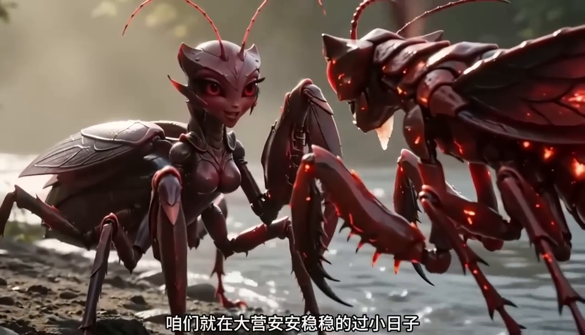

**Story position:** Traveling to the mantis capital, before the Sacred Land campaign. Liang Cheng is the large armored mantis on the right; Scarlet is on the left.

**Appearance:** Dark red and burgundy armor with near-black recesses, red-orange glowing seams, a pointed helmet-like head, long antennae, and thick curved foreleg blades. The body looks densely plated, especially around the shoulders and forearms. The blade edges carry large teeth, while the rear body retains the mantis's segmented insect structure.

**Combat identity:** A Grade 8 body already capable of killing Grade 9 opponents. This period emphasizes speed, blade penetration, intimidation, and attacks on exposed weaknesses. The victories over beetle armor and the scorpion's own venom show practical advantages that a numerical rank alone does not explain.

**Boundary:** No new formal name is supplied for this carryover appearance in the reviewed Season 2 opening.

#### 2. Advanced Form: Void Harvester

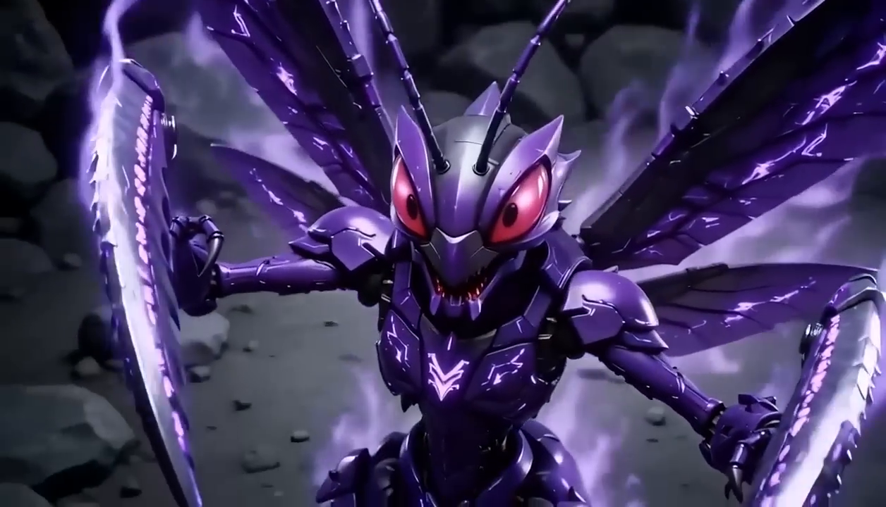

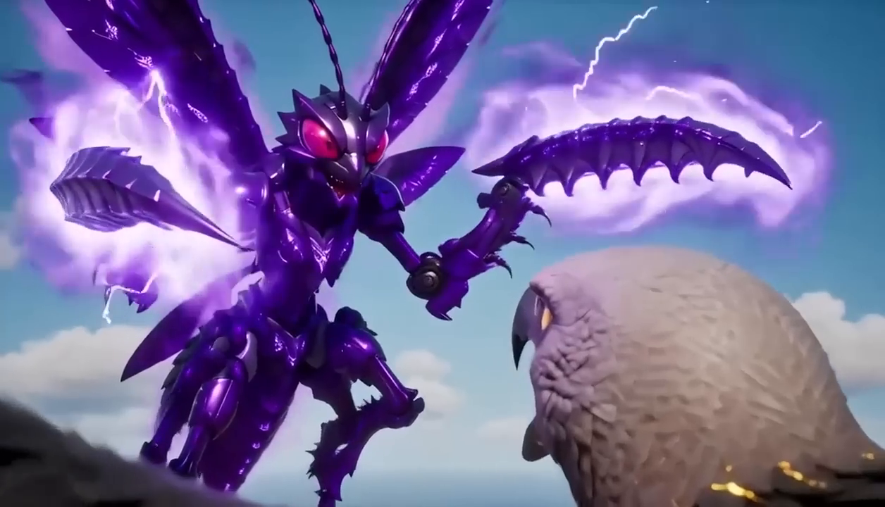

**Story position:** Emergence during the Hundred-legged Centipede invasion, followed by the teleportation and first island campaigns.

**Appearance:** Purple and dark metallic plates replace the earlier red-dominant appearance. The eyes glow pink-red in the selected scenes. Crown-like head spikes, pointed shoulder plates, broad violet wings, and heavily serrated curved scythes make the silhouette more elaborate. Violet energy traces the weapons and surrounding air. The deployed wings show multiple prominent lobes or blades; their exact arrangement varies by shot.

**Confirmed abilities:** Void Rending is described as tripling strength, while Void Crossing triples speed. Void Power is also named. The upgraded consumption system can gain energy from lower-tier prey, though returns diminish.

**Battle applications:** He consumes the centipede's committed energy core and later repeats a comparable counter against the Thunder Eagle. He also defeats the stronger Island Lord through deception and surprise access. These events demonstrate consumption and tactics; they do not independently confirm that he inherits the centipede's Thunderfire or the eagle's lightning talent.

**Translation note:** Void Harvester is the name used throughout this reference for this Advanced Form. It is not a second transformation separate from translations such as Void Reaper.

#### 3. Super Form: violet-eyed armored body

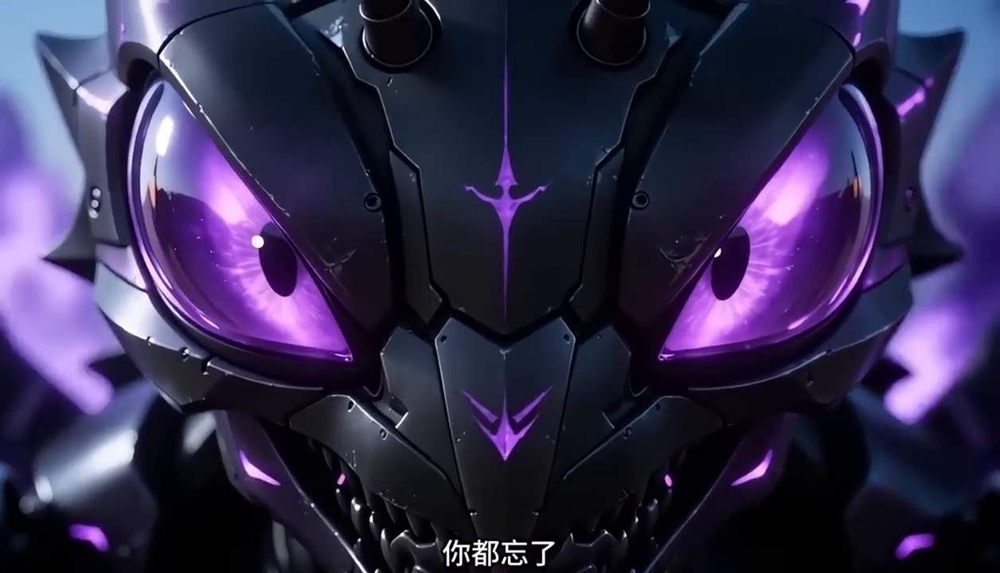

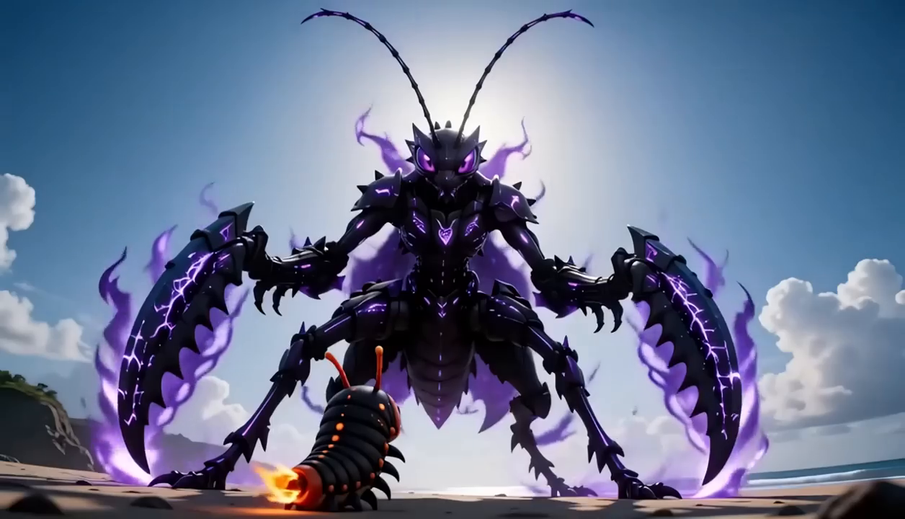

**Story position:** The end of Season 2 and the early-to-middle portion of Season 3. Super Middle is explicitly confirmed by Dashui, and Super High is subsequently identified during the jellyfish battle.

**Appearance:** Glossy black and deep-purple armor, intense violet eyes, and bright violet markings across the face, chest, and limbs. The selected full-body view shows long jointed antennae, a spiked crown, pointed shoulders, a tapered segmented abdomen, and especially broad crescent scythes. Their inner edges are toothed, and violet energy follows the cutting surfaces. The overall shape is darker and more angular than the red opening body.

**Combat identity:** Teleportation and precise attacks allow Liang to threaten creatures above his own form. His strategy also broadens to team fighting, transport, scouting, tribute, and repeated exchanges for Ancient-Race Flesh.

**Name and stage boundary:** No securely verified unique form name is added here. Middle and High describe strength stages within the Super Form. The story's inconsistent caption during later feeding is not treated as proof of a distinct new body.

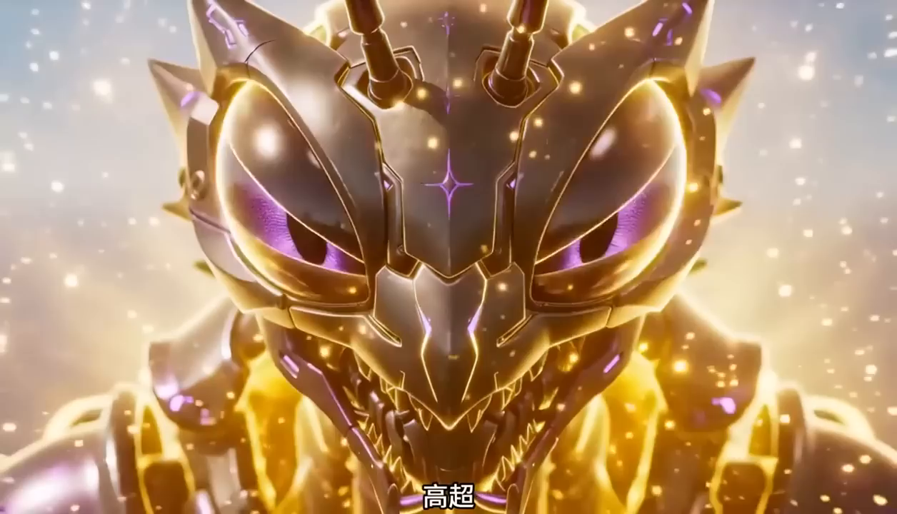

The gold light in this feeding scene is a temporary visual effect. The violet eyes and dark underlying armor remain visible. It does not establish a permanent gold-armored form.

#### 4. Ultimate Form, Early Stage: Void Mantis

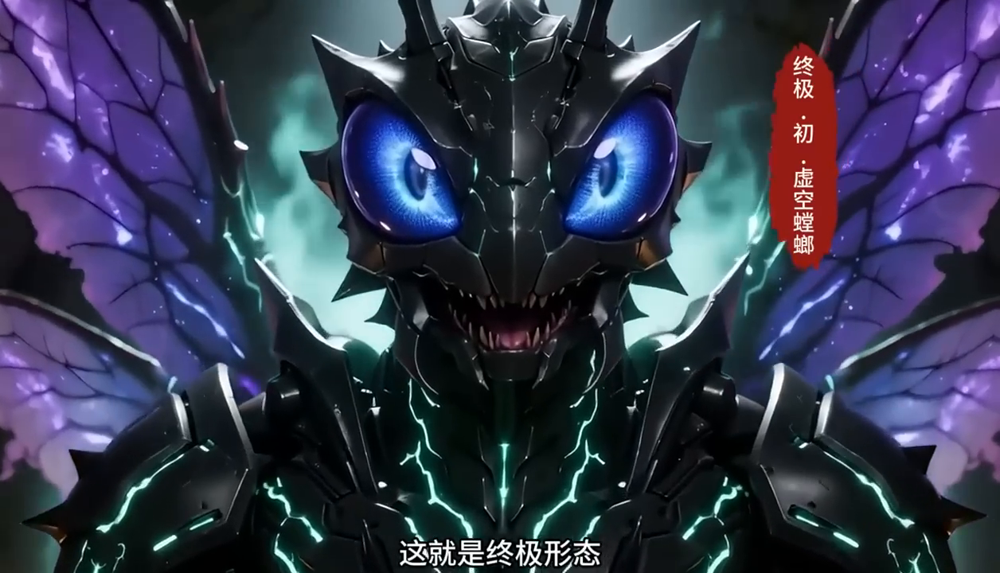

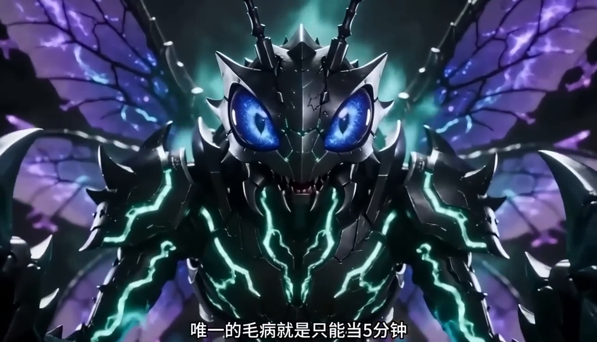

**Story position:** Emergence from seclusion on the island near the Sea of Death.

**Name:** The original title card identifies the **Void Mantis** at **Ultimate Form, Early Stage**. Liang's accompanying dialogue uses **Void Lord**. Both labels belong to the same emergence, so they are presented together rather than counted as two successive bodies.

**Appearance:** A black, sharply spined exoskeleton, bright blue or cyan eyes, and luminous cyan lines cutting through the dark plates. The head carries a tall jagged crest, the chest has a dense armored center, and broad purple wings remain a major part of the silhouette. Heavy scythes and additional spikes reinforce the more aggressive profile. Eye and glow saturation vary with the scene's lighting.

**Confirmed combat change:** Liang reports a 1,000% amplification for Fatal Weak Point. He describes combining it with Death's Shroud as a twentyfold burst lasting five minutes. The stated duration matters: this is a limited combination, not a permanent twentyfold multiplier on all actions.

**Subsequent additions:** Eating the three dragon hatchlings grants Fire, Wind, and Water Proficiency. Those skills are gained after the body's emergence and initially require practice.

#### 5. Elemental attachment configuration

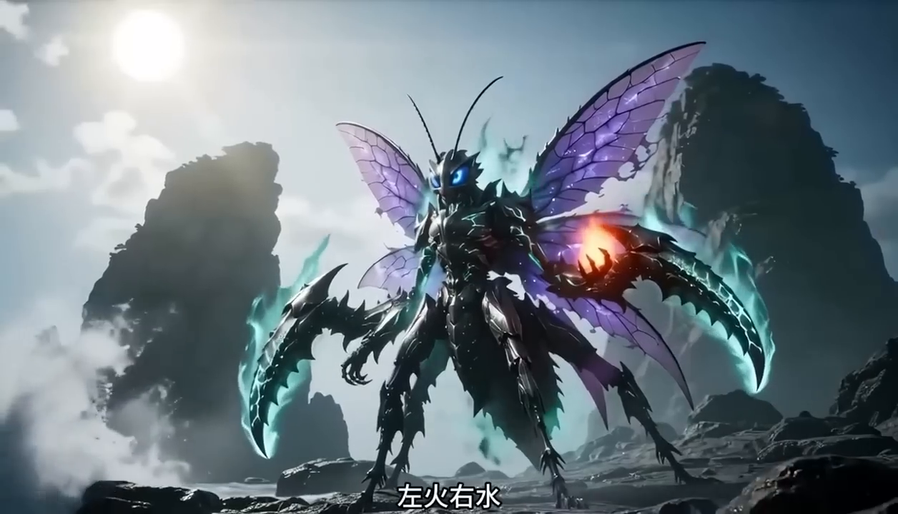

**Classification:** A combat configuration of the Ultimate Void Mantis, rather than a separate evolutionary rank.

**Visible features:** The dark armor, cyan markings, blue eyes, and violet wings remain. Fire produces an orange-red effect on the left scythe, water a blue effect on the right. The Wind Source is attached to the wings. Left and right refer to Liang's body, so they appear reversed in a frontal image.

**Acquisition:** The hatchlings provide initial proficiency. The adult Tricolor Water Dragon subsequently supplies the more powerful Fire, Water, and Wind Sources. Liang learns to channel these through specific body parts rather than merely projecting poorly controlled effects.

**Tactical significance:** Mobility and close-range cutting can now be supported by three different elements. His claims during the dragon battle that water would ruin his blade or overheating had disabled teleportation are deliberate bait, not established weaknesses of this configuration.

#### 6. Ultimate Form, Middle Stage

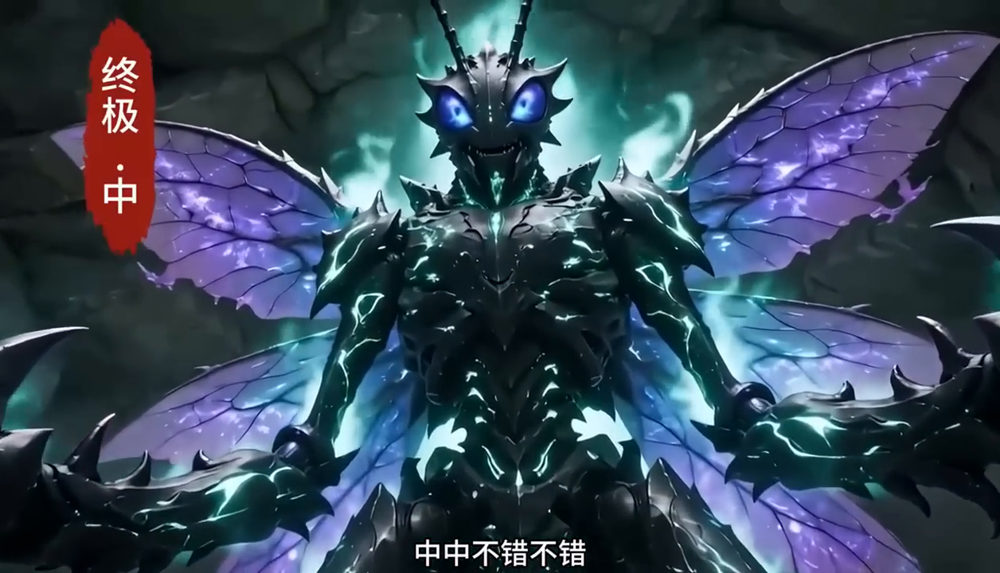

**Story position:** After Central Island's collection and transport network has built a stockpile of Ancient-Race Flesh.

**Appearance:** The same identifiable Void Mantis design persists: blue eyes, black spiked armor, cyan luminous markings, and large violet wings. The selected shot emphasizes the shoulders, chest, and spread wings. The original stage label supplies the firm evidence for advancement.

**Growth mechanism:** More than ten days of income exceeding two hundred jin of flesh per day accumulate into a reserve that Liang consumes. His governing and transport arrangements have become a direct part of his evolution mechanism.

**Boundary:** Ultimate Middle is a confirmed strength increase. The reviewed ending does not establish another uniquely named body or a completed divine transformation. The Eagle King's new expedition is still an unresolved threat at the end of Season 3.

### Major creatures and their relationship to the progression

| Creature or character | Established role or rank | Why it matters |
|---|---|---|
| Grand Elder | Second Tier, Grade 9 | His life-consuming last stand buys time during the centipede invasion. His rank belongs to him, not to Liang's expected breakthrough. |
| Hundred-legged Centipede | Advanced Form | Its attack exposes a concentrated core that Liang consumes. It introduces the danger of enemies beyond the grassland's tiers. |
| Thunder Eagle | Lightning and Wind Power | It threatens the fishing group. Its talents are not automatically inherited just because its core is eaten. |
| Dashui | Ultimate Form giant turtle | Transport, shelter, combat strength, and water control. Liang improves the application of the turtle's existing talent. |
| Flying Golden-haired Mouse Island Lord | Super Form | Liang defeats it while still Advanced Form through deception and repeated attacks. |
| Old Crab King | Super Form, Peak Stage | This opponent's Peak Stage must not be mistaken for Liang's opening Super Middle rank. |
| Jellyfish leader | Ultimate Form | Defense, poison, paralysis, and restraining threads test Liang's teleportation and positioning. |
| Floating Island's ruler | Describes himself as approaching divinity | Controls the flesh exchange and punishes the raiders through pricing. Liang does not defeat him in these seasons. |
| Tricolor Water Dragon | Ultimate Form regional ruler | Its offspring grant three elemental proficiencies; the adult supplies the three sources after a separate battle. |
| Eagle King | New claimant at the Season 3 ending | Sends followers to demand part of Central Island's income. The outcome belongs after this season's stopping point. |

### Names and reference conventions

Liang Cheng is the protagonist. Scarlet and the Mantis Queen belong to the mantis settlement. Bai Hui guides the Sacred Land campaign, while Dazhuang is Liang's earlier companion. Datou leads the Sea-fire Bugs, Dashui is the giant turtle, and You Qian is the appointed Crab King. Wei Kang is the lizard leader involved in the unpaid information deal; Di Kun is the missing lizard prince. Muyu designates Floating Island's ruler, and Li Yan is the Eagle King's envoy. Some personal names are romanized from speech where captions vary.

Kunzhi is retained phonetically because the reviewed captions do not securely establish its written name. The story distinguishes its Divinity Point reward from the experience supplied by ordinary flesh. Quantities reported in **jin** retain that unit.

For further adaptation or AI processing, keep a creature's rank, a resource's grade, Liang's current body, and the abilities he has actually acquired as separate fields. Temporary effects and an opponent's powers are not additional protagonist forms.

## Liang Cheng: Season 4

Detailed chronological story, evolution record, and illustrated form atlas.

Season 4 continues the struggle over Central Island's flesh income. It follows Liang Cheng through the confrontation with Floating Island, advancement into the divine realm, the parasitic crisis among his old companions, and the departure through the Heavenly Gate. The reviewed compilation runs approximately two hours and seventeen minutes. The account ends where that compilation ends, without adding events from the world beyond the gate.

The illustrations are original video stills with their captions and graphics intact. English names for new system terms are reference translations. Unselected evolution options, an enemy's abilities, and another mantis's advancement are kept separate from Liang Cheng's own progression.

### Evolution milestones

**Ultimate Middle → Ultimate High → Ultimate Superior → Ultimate Peak → Initial Divine Realm, Early Stage: Void Deity → Initial Divine Realm, Middle Stage.**

| Point in the season | Liang Cheng's confirmed state | Basis and consequence |
|---|---|---|
| Opening | Ultimate Form, Middle Stage carried over from Season 3 | The conflict begins over the established Central Island income. |
| Early Floating Island strategy scenes | Ultimate Form, High Stage | Muyu describes Liang's rapid progression through Early and Middle to High. This is dialogue evidence, not a newly invented transformation scene. |
| After the favorable trade agreement | Ultimate Form, Superior Stage | The original caption supplies the additional Chao stage label. It occurs after High and before the later Peak milestone. |
| Next promotion, before the first battle with Muyu | Ultimate Form, Peak Stage | Liang says he has reached the top of the form. The subsequent confrontation explicitly identifies him as being at its peak. |
| Preparation for divinity | Peak Ultimate, accumulating Divinity Points | The next target becomes 10,000 Divinity Points. He estimates about eighty further days at his current rate. This estimate is not a new form. |
| Completion of the secluded transformation | Void Deity, Initial Divine Realm, Early Stage | He chooses the Condensation route and emerges with a much smaller, slender purple body. The original panel supplies the new realm and form name. |
| Eating the ancient armored remains | Initial Divine Realm, Middle Stage | Consuming the shell supplies enough Divinity Experience for a promotion. The announcement mentions 35,000 points, and a nearby display shows 35,900. These readings are not converted into an exact reward formula or universal threshold. |
| Return to Floating Island | Same divine body, enlarged manifestation available | Heaven-and-Earth Manifestation reveals a gigantic true-body expression. It is an ability of the chosen route rather than an additional realm promotion. |
| Final battles and departure | Divine Liang Cheng; no further securely identified stage | He consumes the returning Muyu and kills Parasitic Demons, then leads the group through the gate. No additional named rank is added solely from those meals. |

**Superior Stage** is the English label used here for this season's additional Chao subdivision. It belongs within **Ultimate Form** and must not be confused with the earlier **Super Form** tier. Its position is established by the sequence of scenes; the reference does not invent a complete universal stage chart beyond what is shown.

Divinity Points before the breakthrough and Divinity Experience afterward are recorded separately. The references to Dazhuang's rapid promotions, his false Ultimate state, and his later drop to Ultimate Early belong to Dazhuang, not to Liang Cheng.

### The six divine evolution options

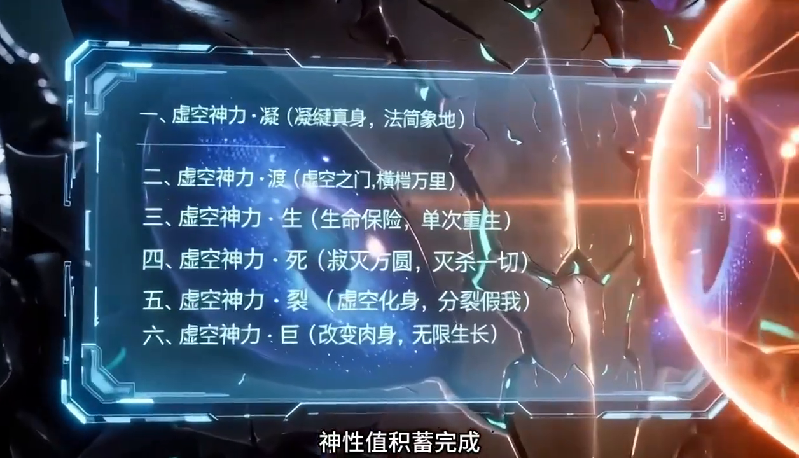

The screen presents six routes. Liang selects the first, and the choice is described as irreversible. The table translates their functions rather than treating every displayed option as an ability he possesses.

| Route | Offered function | Selection |
|---|---|---|
| Void Divinity: Condensation | Condense a true body and gain Heaven-and-Earth Manifestation. | **Chosen.** Strengthening the body supports his preferred direct combat. |
| Void Divinity: Crossing | A Void Gate for very long-distance traversal. | Not chosen. |
| Void Divinity: Life | A life-preserving opportunity for a single rebirth. | Not chosen by Liang at this selection. Later companions' survival powers must be considered separately. |
| Void Divinity: Death | An annihilating effect over the surrounding area. | Not chosen. |
| Void Divinity: Division | Void manifestations or divided substitute selves. | Not chosen. Muyu's own Fission is a different character's power. |
| Void Divinity: Giant | Alter the flesh for continuing bodily growth. | Not chosen. This is distinct from the manifestation granted by the first route. |

### Season 4: Floating Island, Divinity, and the Heavenly Gate

#### 1. The tribute demand becomes an interrogation

A brief return to Dazhuang's family life precedes the confrontation at Central Island. Li Yan arrives with Sea-fist Shrimp, claiming authority from Muyu and demanding 180 jin of Ancient-Race Flesh every day. Since the island's daily receipts are only a little above two hundred jin, Dashui recognizes the demand as confiscation disguised as tribute.

Liang Cheng initially agrees, lowering the visitors' guard before attacking. Death's Shroud and his burning scythes turn the supposed collection visit into a slaughter. He keeps Li Yan alive for information. When frightened island leaders urge him to release the captive, Liang Cheng says they must personally supply the future tribute without touching his or Dashui's shares. Their preference for appeasement immediately disappears, and they help force Li Yan to answer.

The interrogation establishes that Muyu has not yet passed beyond Ultimate Form. It also explains the island's resource: a hollow, pale Ancient-Race bone about thirty meters long absorbs energy and regrows flesh. If allowed to continue, it develops skin, ringlike markings, and a flattened clawlike end, accompanied by an intimidating presence. Muyu repeatedly removes the new flesh instead of allowing that process to finish. Two other powerful defenders serve him: the Giant-clawed Crab King and a giant bloodsucking mosquito.

#### 2. Muyu's trap and the invented tribal chiefs

Muyu knows that the Eagle King and Li Yan used his name to seek private gain. He forbids further seizure of flesh after legitimate trades, but Liang Cheng's growth concerns him for a different reason. He recalls the mantis defeating the Tricolor Water Dragon at Ultimate Early Stage and then rapidly reaching Middle and High Stage. Unable to abandon the Ancient-Race remains, Muyu needs to draw him onto Floating Island.

He announces an eight-hundredth-birthday celebration. Every attending tribal chief may receive one hundred jin of flesh, while Liang Cheng is offered ten thousand. Liang Cheng identifies the exceptional invitation as bait. He and Dashui stay away, but he appoints more than a hundred temporary chiefs, inventing new tribes from differences such as unusual feathers or missing limbs. Each receives a stone identity token and goes to claim the public reward.

Muyu honors the offer because breaking it would damage the exchange's reputation. Back at Central Island, Dashui collects sixty percent from the beneficiaries despite Liang Cheng's earlier promise not to levy their gifts. Liang Cheng performs a brief show of disapproval, accepts the supposedly voluntary contribution, and dissolves the temporary tribes. Consuming his share grants 17.368 billion energy points and sixty-one Divinity Points.

#### 3. The Nine-Star Alignment and a struggle over supply

Dashui notices nine stars approaching alignment and recalls his people's ancient promise that gods will descend, open a heavenly gate, and offer ascension. Liang Cheng proposes a darker interpretation: their world could be a breeding ground, with the gods arriving when its creatures are ready to be harvested. This remains his suspicion, not an established explanation of the world's origin.

Meanwhile, Floating Island cuts Central Island's exchange return to one third of its former level. An appeal would bring Liang Cheng into Muyu's trap. A simple boycott would also fail: Central Island supplies about sixty percent of the trade, leaving Muyu other customers while Liang Cheng's followers lose all access to flesh.

Liang Cheng therefore seeks control of the remaining supply. The Quickfish rebuild their intelligence network; he and Dashui intercept caravans in separate areas, while the Sky-swallowing Rats supplement the crabs' collection work. Cores are accumulated at Central Island instead of being exchanged. His target is control of eight or nine tenths of the available supply, depriving the Ancient-Race remains of their feedstock. He warns defeated traders to stop visiting Floating Island. This blockade threatens Muyu much more directly than the previous toll-taking operation.

#### 4. Defeating the two deputy rulers

Muyu responds to Liang Cheng and Dashui operating separately by sending the Giant-clawed Crab King and the giant mosquito against the mantis. Their ambush attacks from different directions. Liang Cheng disables the mosquito with one strike, leaving the crab to fight without its intended partner.

The crab challenges him to enter the sea and contest its claws directly. Liang Cheng instead gains height, creates the expectation of a descending attack, and strikes a vulnerable area. Only after weakening it does he accept a direct exchange. The crab is killed, while the mosquito remains available for interrogation.

The captive claims Liang Cheng might have an even chance against Muyu and warns that Muyu could attain divinity within a year. Liang Cheng recognizes these arguments as another attempt to draw him onto Floating Island. Under pressure, the mosquito admits that its instructions were to lure him there if the assassination failed.

With both deputies lost, Muyu temporarily concedes the economic dispute. He promotes the Eagle King and sends him to announce restored trading terms and repayment of the withheld flesh. Liang Cheng recognizes the messenger's involvement in the original extortion. The eagle's attempt to deny his identity fails, and Liang Cheng kills him. He accepts that Muyu is ready to negotiate, but does not consider restoration of the old price sufficient compensation.

#### 5. Negotiating a better exchange

Liang Cheng sends three bird representatives to bargain: a seabird, a fire turkey, and a One-legged Crane. One highest-grade core previously purchased ten jin of flesh; his minimum acceptable new rate is twenty. He offers the negotiators a commission on anything obtained above that floor, giving them a personal reason to resist intimidation.

The delegation escalates its opening demand from fifty to eighty and then two hundred jin per core. Muyu objects that the last figure exceeds what a core can produce. When he tries to stop them leaving, they point out that killing the delegates would prolong the blockade and threaten the remains themselves. Bargaining finally settles at thirty jin, three times the original rate. Liang Cheng rewards each delegate with an additional fixed allowance of ten jin per day.

The increased flow gives his organization several hundred jin daily and accelerates his evolution. He still refuses an immediate attack on Muyu: an even chance of victory is inadequate when continued growth offers a safer prospect. He then reaches **Ultimate Form, Superior Stage**. The status readout lists Absolute Devouring, Divine Body, Sovereign Insect Domain, Extreme Speed, and Calamity Venom; this does not establish that each talent is newly acquired at that moment.

#### 6. Old companions reach the sea

Dazhuang, Scarlet, and their queen activate the old teleportation formation and arrive on the volcanic island associated with Liang Cheng's earlier journey. They have left the children with the elders and hope to find him, obtain better resources, and establish a future base for their people.

The island's spiny insects are effective hunters at sea but poor fighters on land. The newcomers exploit that limitation to obtain fish and discover that the marine prey contains valuable Energy Cores. They also learn that Liang Cheng has already moved on.

Meanwhile, Liang Cheng advances again and reaches the peak of Ultimate Form. His progression display changes from Flesh Points to Divinity Points, with a ten-thousand-point requirement for the next major breakthrough.

Datou finds the three visitors during a nostalgic return to the island and reports to Liang Cheng. Liang Cheng sends Dashui to collect them, with Datou as guide and five hundred jin of flesh for the journey. At the same time, Floating Island abruptly ends all exchanges and expels its residents. Reports suggest that Muyu has stopped eating, appears partly paralyzed, and has prohibited anyone from returning for three years.

Liang Cheng suspects a staged breakthrough designed to make Muyu look vulnerable. Nevertheless, he cannot obtain Divinity Points through the exchange while it is closed, nor can he safely wait for his enemy to grow stronger. He decides to investigate in person.

#### 7. The first battle with Muyu

The apparent retreat is indeed a trap. Muyu expects to kill Liang Cheng on the island, only to discover that the mantis has already reached the peak of Ultimate Form. Liang Cheng, in turn, finds an opponent with eight talents and a divine survival ability, developed across a life of approximately thirteen hundred years.

Muyu's eight arms initially overpower him. Their compression is so tight that Liang Cheng cannot spread void power around his entire body, preventing teleportation. This is an actual failure under restraint, unlike the false inability to teleport that he used to deceive the Tricolor Water Dragon. He describes the exchange as his worst setback since entering this world.

He then activates Death's Shroud and commits to its five-minute combat window. A void-based field slows Muyu, while Liang Cheng's speed leaves persistent afterimages and allows repeated attacks. Muyu survives the destruction of his large body through Fission: a small octopus formed through absorbed core energy attempts to hide among the remains, uses a falling stone as a distraction, and escapes.

Liang Cheng wins possession of Floating Island, but Muyu is not yet permanently dead. The followers who celebrate over the ruined octopus body do not know the full outcome. Liang Cheng understands that the escaped creature may return, while the fugitive later admits that it retains only half its former strength.

#### 8. Controlling the resource and confronting an infection

Liang Cheng installs his bird representatives as Floating Island's administrative core and rewards participating chiefs with fifty jin of flesh per day. Control of the producer changes his pricing policy: ordinary traders again receive the old ten-jin return, rather than the thirty-jin rate he negotiated when he was the buyer. He reserves the larger share of production for his own organization.

Dashui arrives with the three mantises. Their former queen has relinquished her position and introduces herself as Feiyan, with the childhood name Xiaofen. Liang Cheng gives them access to Ancient-Race Flesh and orders Datou to attract more trading groups. With the supply secured, he accumulates enough divinity to prepare for seclusion, leaving Dashui under strict orders to protect the island without departing.

Before leaving, he learns that Dazhuang's growth is abnormal. After reaching Advanced Form, Dazhuang consumes enormous quantities of flesh and immediately enters another sleep to advance toward Super Form. He also has an extreme fear of seawater. Scarlet is developing the same fear.

Liang Cheng uses seawater to expose Scarlet's parasite, but cannot safely kill it: host and parasite are linked, so destroying the creature would also kill her. Its emergence also disrupts her memory. Feiyan may be infected as well. With no immediate cure and his own advancement ready, Liang Cheng tells them to avoid the sea and await his return.

#### 9. Choosing a divine body

Liang Cheng finds an ancient, exceptionally hard carcass near the Sea of Death and uses it as a secluded refuge. His entry into the divine realm requires an irreversible choice among six evolutionary paths.

He rejects an enlarged teleportation option as redundant, an immense permanent growth route as making him an obvious target, and a high-output option with poor endurance. Other choices involve unacceptable risk or copies with only thirty percent of his strength. He selects True-Body Condensation, which strengthens him broadly and includes Heaven-and-Earth Manifestation, a power that can enlarge his combat presence when required.

During the long sleep, the others continue to change. Dazhuang learns about the parasite after awakening; Scarlet prepares for another advancement, and Feiyan develops symptoms. Dashui grows so large from the island's food that he can no longer comfortably leave the cavern, yet remains at his assigned post because damaging the remains or abandoning them would threaten everything Liang Cheng has entrusted to him.

Liang Cheng finally emerges as a Void Deity at the early stage of the Initial Divine Realm. His body has condensed to roughly two meters, with a slender purple form. The former skill list no longer appears as before, but his talents still include water, fire, wind, Concealment, and Void Control. He observes that his ordinary movements now exceed the strength of his previous all-out attacks.

#### 10. A second divine advancement and a delayed return

The ancient shell that Liang Cheng could previously barely scratch can now be cut with half his strength. Eating it supplies enough Divinity Experience for him to advance to the middle stage of the Initial Divine Realm.

He then explores beyond the Sea of Death in search of further growth. Ordinary Ultimate Form creatures no longer provide the divinity he needs. Finding a concentration of the ancient Kun creatures might help, but the world is vast and his search does not produce a better source. Returning to Floating Island remains the reliable alternative.

Only then does he reckon with the time that has passed: the long advancement and subsequent exploration have kept him away for more than three years. Dazhuang has reached an externally impressive but compromised Ultimate state and is still trying to delay the parasite's final development.

Liang Cheng's small body causes a guard to mistake him for an insignificant visitor. He demonstrates Heaven-and-Earth Manifestation, appearing more than three hundred meters tall with enormous scythes, before resuming his compact size. Dazhuang cannot damage him even when invited to strike. His return restores hope, but he still has no simple method of removing the parasites safely.

#### 11. A narrow rescue plan and Muyu's final defeat

Liang Cheng recalls that Muyu obtained a survival power while approaching divinity. He tells the infected mantises to choose a life-preserving or rebirth ability if such an option becomes available during their own breakthrough. It may allow him to destroy the parasite without permanently losing the host. He cannot promise that all three will receive a suitable choice, and delaying forever will not prevent the crisis.

Meanwhile, Muyu completes his own divine advancement and returns to reclaim the Ancient-Race remains. He hopes Liang Cheng is still vulnerable in seclusion. Seeing only a two-meter mantis in the cavern, he mistakes the changed body for weakness and attacks.

The anticipated clash between divine opponents is overwhelmingly one-sided. Liang Cheng kills and consumes Muyu so quickly that Dashui is astonished by the lack of resistance. Liang Cheng values the meal at roughly one hundred days of ordinary energy intake. This ends the threat from the octopus that escaped the earlier battle.

Dashui also reports that the nine stars are close to alignment, perhaps two years away. Liang Cheng plans to leave himself time to hide before the predicted descent of the gods, rather than assuming that superior strength makes the event safe.

#### 12. The parasites mature, and Scarlet is lost

Dazhuang's parasite reaches maturity and emerges as a long purple Parasitic Demon capable of speaking through transmitted thoughts. It intends to consume the host that has sustained its growth. Dazhuang's survival mechanism gives him the opening Liang Cheng needs to intervene.

The demon turns its aggression against Liang Cheng. He meets it with his transformed power, cuts the elongated creature into separated sections, and devours it. Dazhuang survives, but his strength falls back to a weak Early Stage of Ultimate Form. Seeing how much Liang Cheng gains from the parasite, he suspects that his leader deliberately allowed it to grow. Liang Cheng denies this and reiterates the survival constraint: forced removal would have killed the host, while the divine breakthrough offered a chance of survival.

The same danger remains for Scarlet and Feiyan. Their chances depend on whether they can obtain the necessary rebirth power when their parasites emerge. Feiyan survives; Scarlet does not.

Dazhuang does not hold Liang Cheng responsible for the infection or claim that earlier forced removal would certainly have saved her. He recognizes that he and Feiyan would otherwise have had no chance. His grief centers on being powerless when Scarlet needed help. The parasite crisis therefore ends with two survivors and a permanent loss, not a complete rescue of the group.

#### 13. A dangerous offer to starving mantises

Liang Cheng brings in other starving mantises and offers abundant Ancient-Race nourishment. He also tells them the danger plainly: if they carry Parasitic Demons, enough energy may awaken the creatures and kill their hosts. Those who decline can be transported back.

The mantises choose to stay. Their alternative appears to be continued starvation, so they accept the chance to grow even at the risk of dying. Four individuals show no corresponding movement in their abdomens after eating. Liang Cheng suggests that prolonged hunger may already have starved their parasites before killing the hosts.

This observation introduces a possible explanation for those four survivors. It does not establish a reliable or harmless cure for every infected mantis. The choice also shows the unequal conditions surrounding Liang Cheng's resource monopoly: access to food creates an opportunity, but his weaker relatives must accept risks he can largely overcome himself.

#### 14. The Heavenly Gate reveals another world

The Nine-Star Alignment finally occurs. An immense ancient divine hand and a towering mountain confirm that the old legend describes a real event. Creatures from land and sea gather to climb toward the Heavenly Gate, with weaker or unlucky travelers falling during the ascent.

Dazhuang rides the fire turkey to investigate. At the summit, the apparently watery barrier behaves as a teleportation formation. Onlookers interpret it as a gift leading to a rich new realm. Images of small, apparently defenseless descendants of the gods encourage the belief that crossing will provide limitless prey and rapid evolution.

Dazhuang recognizes the figures as humans. Their lack of claws, fangs, or stingers does not mean they are harmless: their intelligence and weapons can outweigh the visitors' natural advantages. He also warns that the passage is one-way. He persuades the impatient turkey to return instead of rushing through, drawing on what Liang Cheng has previously taught him about humanity.

Liang Cheng has meanwhile hidden away for five months to avoid the celestial event. After emerging, he questions a snake about the new mountain and then observes the gate himself. Returning to his followers, he confirms that the destination is a human world and that its inhabitants may be far more dangerous than they appear.

#### 15. Choosing to cross, after removing the alternative

Despite the danger, Liang Cheng decides to migrate. The familiar world offers increasingly poor prospects for further divine growth. Some followers, particularly the Sky-swallowing Rats, prefer to remain safely at Floating Island and continue eating Ancient-Race Flesh.

Liang Cheng says they may choose freely, then consumes the Ancient-Race remains. This removes the permanent food source that makes staying attractive. The rats reverse their decision and agree to follow him. The sequence matters: the supply did not simply run out on its own, and their consent follows his deliberate removal of their preferred alternative.

Other companions pledge to join. He also gives the recently recruited mantises a choice between accompanying him and returning to Central Island, while making clear that Floating Island will no longer provide their former food. They elect to go. The group receives three days to prepare, with instructions against bringing entire families.

Dashui's immense size and lack of wings make the mountain an obstacle, so Liang Cheng supplies the speed and transport needed to bring him up. At the gate, Liang Cheng volunteers to enter first and tells the others to follow. The season ends with the party crossing the teleportation barrier; their battles and living conditions in the human world have not yet been shown.

### Illustrated form atlas

#### 1. Opening Ultimate body: continuity with Season 3

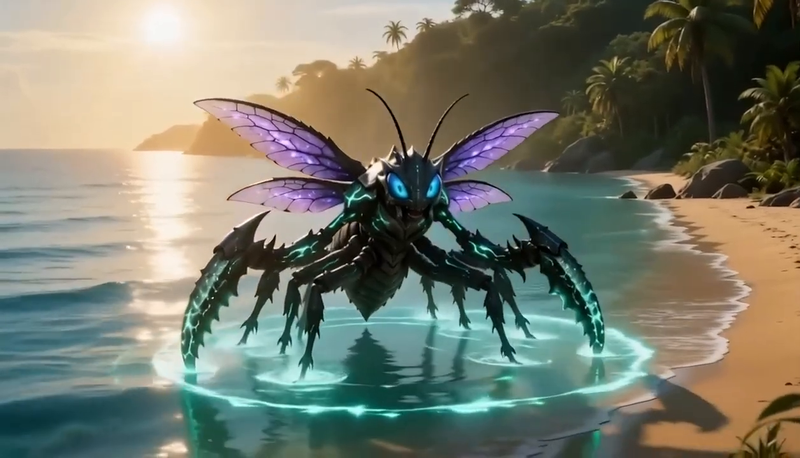

**State:** Ultimate Middle at the previous season's ending, with High Stage subsequently reported by Muyu during this season's early strategy discussion.

**Appearance:** Black plated armor, bright cyan seams, glowing blue eyes, four prominent violet wing blades in the selected shot, and heavy scythes with large serrations. The pointed abdomen and spiked limb armor continue the established Void Mantis design. The water and cyan light around the feet are scene effects rather than a separate aquatic form.

**Evidence boundary:** This image records the opening body. The later High-stage identification comes from dialogue, so a separate High-stage transformation image is not invented.

#### 2. Ultimate Form, Superior Stage

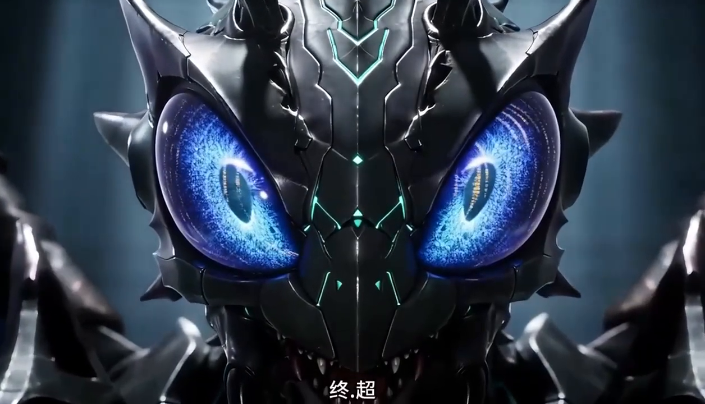

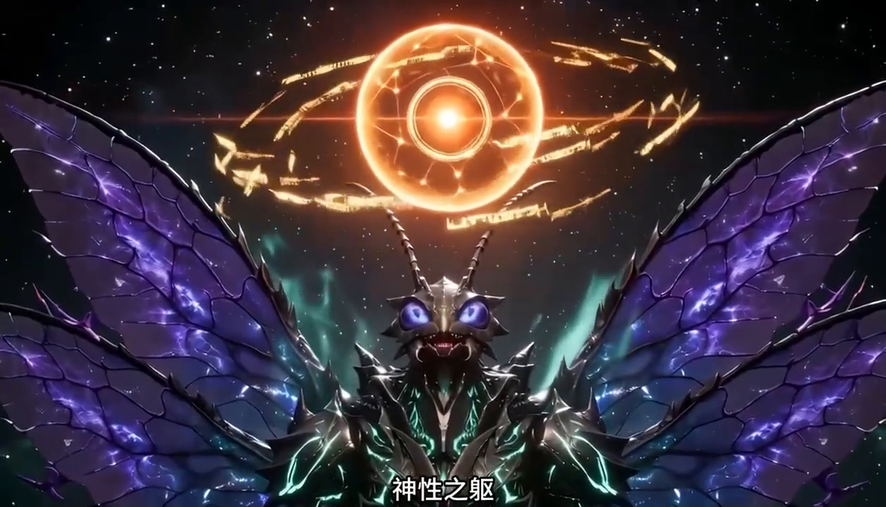

**Position:** After the negotiated improvement in the flesh exchange. The stage is labeled Chao in the original scene and rendered **Superior Stage** in this reference.

**Appearance:** The dark, broad armored build remains, with intense blue-violet eyes, cyan luminous channels, a spiked head and shoulders, broad translucent violet wings, and large hooked scythes. Orange rings and the floating orange sphere belong to the promotion presentation. They are not treated as permanently attached anatomy.

**Readout:** The scene lists Absolute Devouring, Divine Body, Sovereign Insect Domain, Extreme Speed, and Calamity Venom. Listing these names establishes their association with the readout; it does not independently prove that every one was first acquired at this exact moment or specify unshown numerical effects.

**Name uncertainty:** The subtitle track includes a species designation ending in King Insect, but its complete written name is not securely recoverable from the reviewed frames. The atlas therefore identifies this entry by its confirmed stage rather than supplying an invented complete title. The talent name Divine Body also does not mean Liang has already entered the divine realm.

#### 3. Ultimate Form, Peak Stage

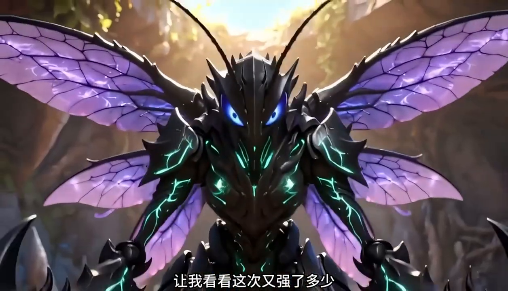

**Position:** The next advancement, before the first personal fight with Muyu. Liang's account and the subsequent battle establish that he has reached the peak of Ultimate Form.

**Appearance:** The recognizable black armor, cyan channels, vivid blue eyes, and violet wings continue. The selected view shows broad shoulder protection, dense chest armor, and a jagged crown. It supports continuity of the design rather than proof of an entirely different species.

**Progression change:** The next major advance depends on Divinity Points, with a stated target of 10,000. Liang expects to accumulate what remains over roughly eighty days at his current rate. A separate half-divine body is not shown as a compulsory protagonist step.

**Combat limit:** Muyu can squeeze him so tightly that void power cannot surround his whole body, preventing teleportation. Liang must escape the disadvantage through his combat burst, field effect, and speed. This is a demonstrated constraint in this battle, unlike his deliberate false claims during the dragon fight.

#### 4. Void Deity: Initial Divine Realm, Early Stage

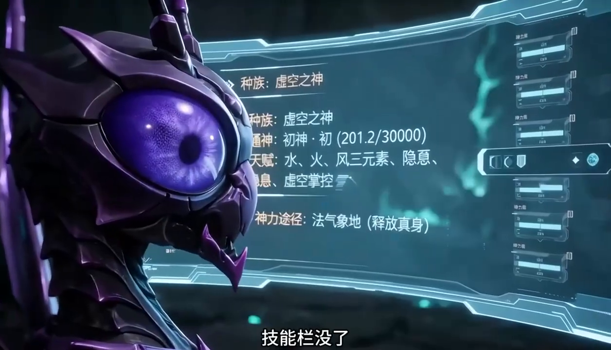

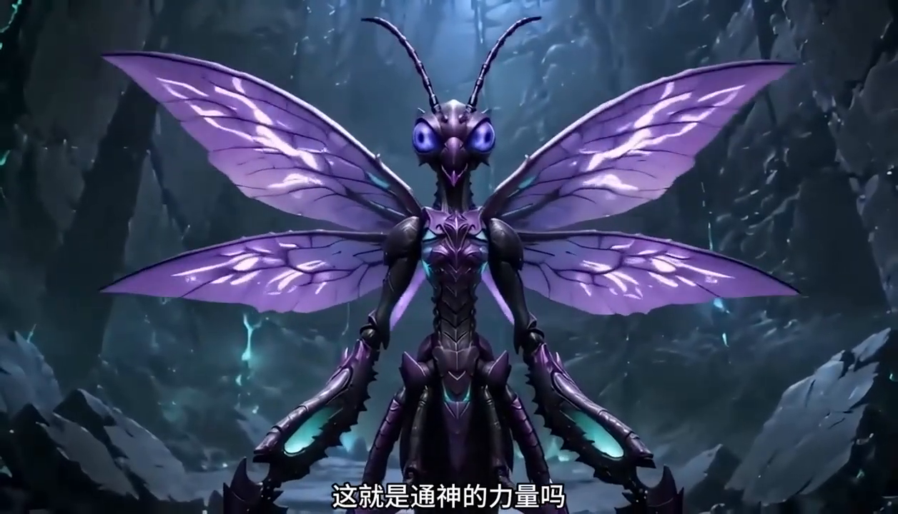

**Position:** Completion of the long retreat after selecting True-Body Condensation.

**Appearance:** The ordinary body condenses to about two meters and becomes markedly more slender. The neck and torso are elongated, purple and dark-violet plates replace much of the earlier bulky silhouette, and four pale-violet veined wings spread broadly from the back. The antennae remain long, the eyes appear violet to blue, and the paired scythes are narrower relative to the body, with cyan-lit inner surfaces and toothed cutting edges. Some cyan accents remain on the chest and lower body.

**Strength:** The smaller frame is a concentration of power. Liang says his basic actions now exceed his previous full-power attacks, and he can cut the ancient shell that resisted him before.

**Interface change:** The old skill section disappears from the display, while the panel still lists water, fire, wind, concealment, and void control among the talents. One intervening entry is partly obscured. This is enough to reject the claim that all earlier powers were erased, but not enough to assign an exact fate to every former named move.

**Chosen divine ability:** Heaven-and-Earth Manifestation belongs to the Condensation route. The other five route options remain unselected.

#### 5. Initial Divine Realm, Middle Stage

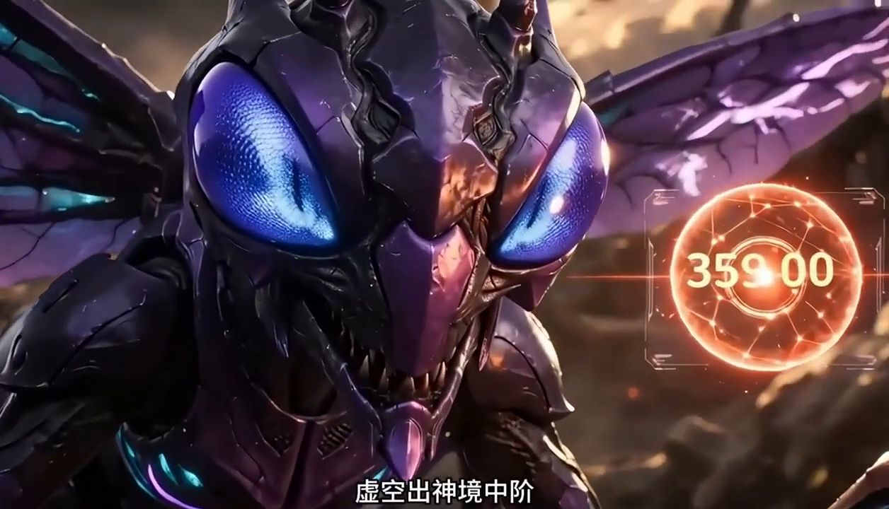

**Position:** Immediately after Liang eats the ancient armored remains around his retreat.

**Appearance:** The divine purple-body identity persists. The selected close-up emphasizes large blue-violet eyes, dark violet facial plates, cyan traces, and purple wings. Differences in the face's proportions between shots do not establish another named body.

**Growth mechanism:** The remains yield Divinity Experience where ordinary Ultimate creatures later prove insufficient. Eating this resource causes the next stage promotion.

**Numerical evidence:** The announcement reports 35,000 points while this nearby display reads 35,900; the earlier panel also contains a different denominator. These inconsistent presentation details are retained as observations rather than reconciled into a fabricated precise cost or a fixed per-carcass reward. The Middle-stage advancement itself is clear.

#### 6. Heaven-and-Earth Manifestation

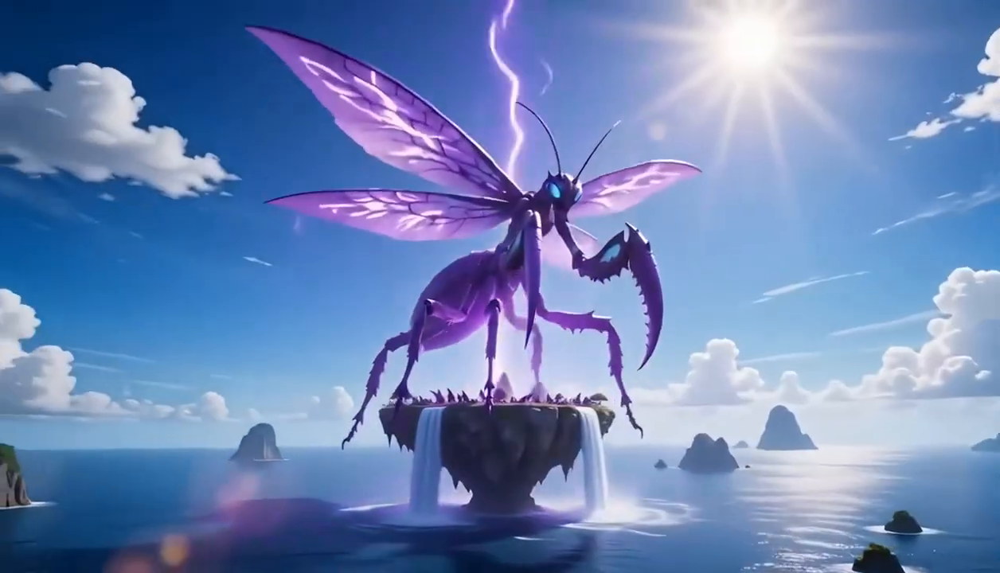

**Classification:** An expanded expression of the chosen divine body, not a newly acquired evolutionary realm.

**Appearance:** The slender mantis design is enlarged to dominate the island: long legs, a segmented abdomen, huge curved scythes, and sweeping violet wings. Its outline remains related to the compact Void Deity rather than becoming a separate beast.

**Scale:** Witnesses describe Liang as more than three hundred meters tall and estimate the scythes at roughly five hundred meters. These are dialogue descriptions, not a measured model sheet. The illustration communicates the intended enormous scale without requiring every rendered proportion to agree with those estimates.

**Function:** The display makes his transformed identity undeniable to the inhabitants who dismissed his two-meter body. He can resume the compact form afterward. The unselected Giant route offered continuing bodily growth and should not be merged with this manifestation ability.

#### 7. Parasitic Demon: a separate creature

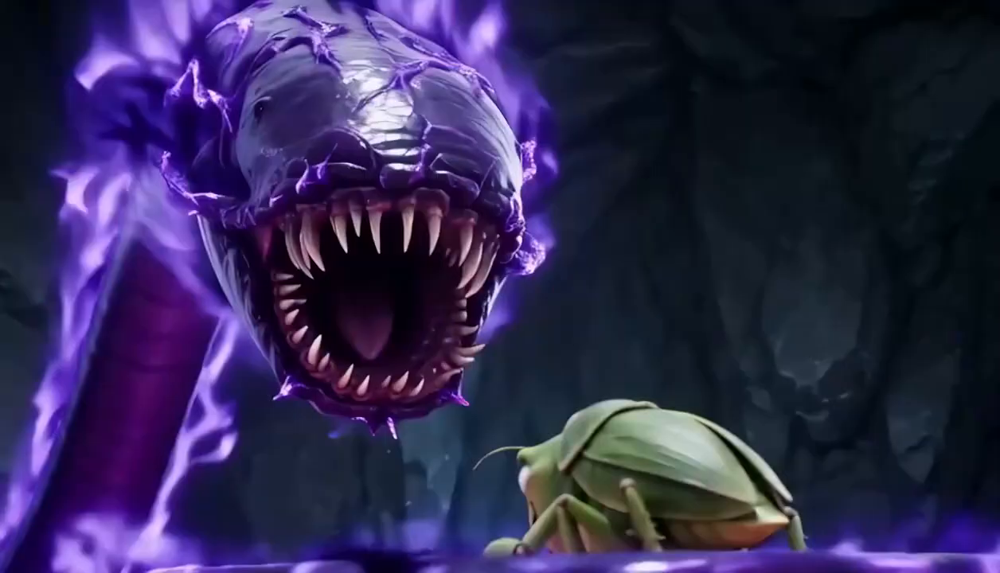

**Classification:** An enemy developing inside a host. It is not one of Liang Cheng's forms.

**Appearance:** A long purple wormlike body, a ridged armored head, a wide circular mouth lined with pointed teeth, and a violet aura. The emerging creature is much larger than the ordinary mantis body beside it.

**Mechanism:** Host growth feeds the parasite's maturation. Fear of seawater, unusually rapid advancement, and extreme appetite expose the problem. Seawater can reveal or draw out the creature, but removing it does not by itself offer a safe cure because host and parasite are linked.

**Resolution:** Liang relies on the host having a suitable survival or rebirth power, then cuts the emerged demon into sections and consumes it. Dazhuang and Feiyan survive; Scarlet dies. The suspected absence of living parasites in four long-starved mantises remains an observation and hypothesis, not a universal treatment rule.

### Abilities and character outcomes to keep distinct

| Item | Owner or status | Reference distinction |
|---|---|---|
| Absolute Devouring, Divine Body, Sovereign Insect Domain, Extreme Speed, Calamity Venom | Liang's Superior-stage readout | No unsupported multiplier or poison formula is added. |
| Death's Shroud | Liang, used in the first Muyu battle | The five-minute combat window remains significant before divinity. |
| Void field used against Muyu | Liang | The reviewed dialogue does not conclusively establish that its name is an exact synonym for Sovereign Insect Domain. |
| Fission | Muyu | Enables escape from the first defeat. Liang does not acquire it merely because it appears on screen. |
| Heaven-and-Earth Manifestation | Liang's selected divine route | Permits the gigantic display while his normal divine body remains small. |
| Survival or rebirth abilities | Infected companions' possible choices | Their availability determines who can survive the parasite's emergence. They are not all automatically granted Liang's chosen route. |
| Dazhuang and Feiyan | Survive the parasite crisis | Dazhuang explicitly drops back to a weakened Ultimate Early state. This is not Liang's rank. |
| Scarlet | Dies during the parasite crisis | Her death remains part of the final outcome. |
| Muyu | Escapes the first battle; dies after returning as a divine opponent | Destruction of his first large body is not his final death. |
| Giant-clawed Crab King | Muyu's deputy, killed in the blockade conflict | A different individual from You Qian, the Crab King appointed by Liang in Season 3. |

### Departure state

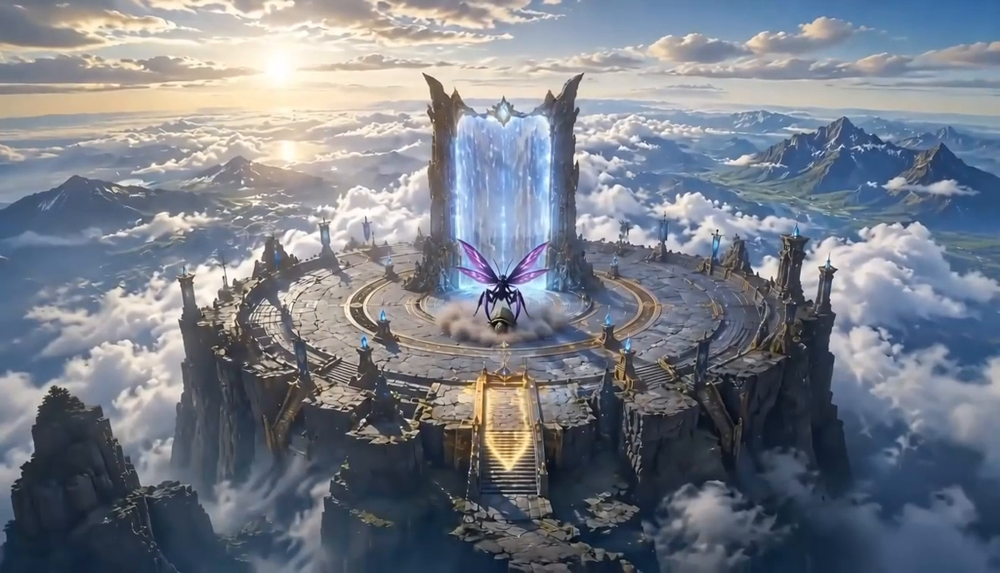

Liang reaches the gate as the divine leader of the surviving group. He has removed the Ancient-Race remains from Floating Island by consuming them, ending the food supply that some followers hoped to retain. Their migration follows that decision. The party enters the one-way passage, and the reviewed season stops before depicting its life or battles in the human world.

Feiyan is the former Mantis Queen; Xiaofen is her childhood name. Scarlet is Dazhuang's partner. The reference retains these identities across the reunion and parasite events. The infection's original route is not established: Ancient-Race Flesh accelerates growth, but the earlier symptoms prevent treating its first consumption as the proven moment of infection.
