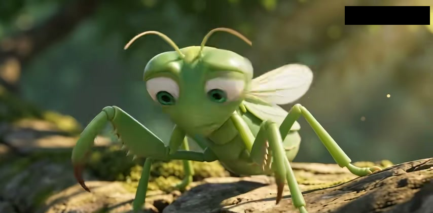
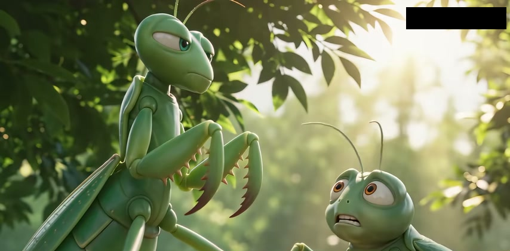
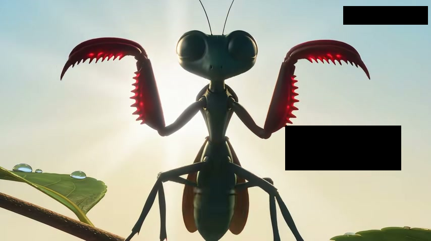
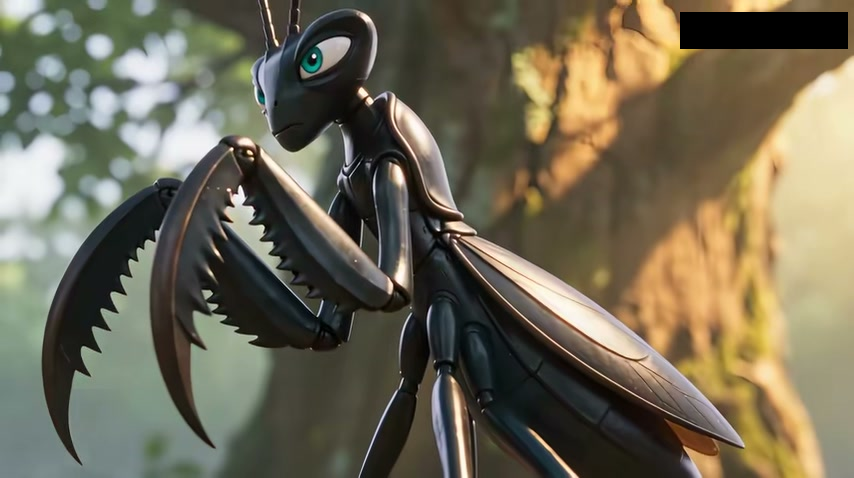
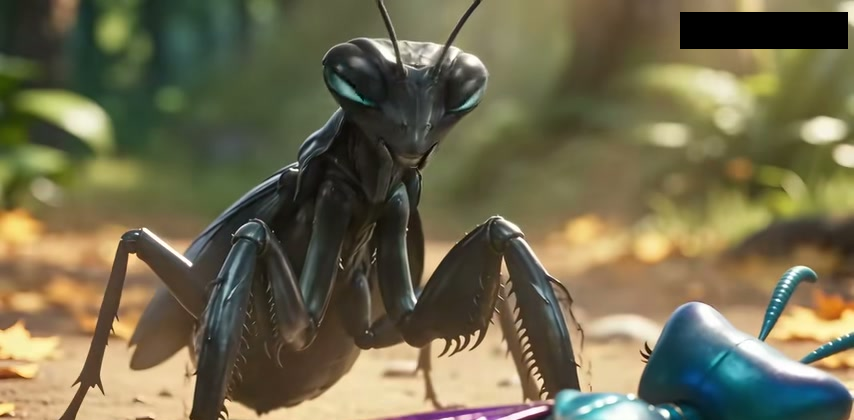
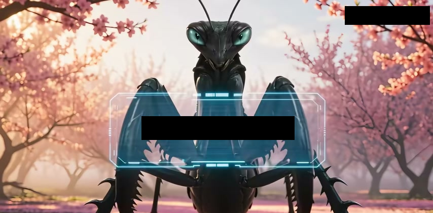
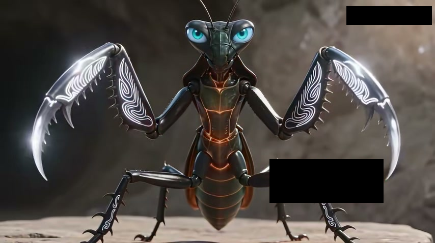
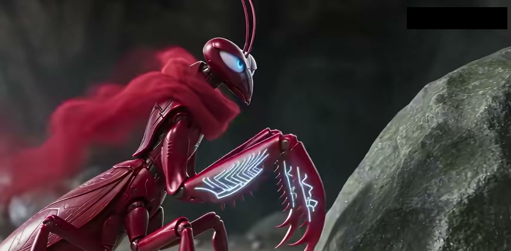
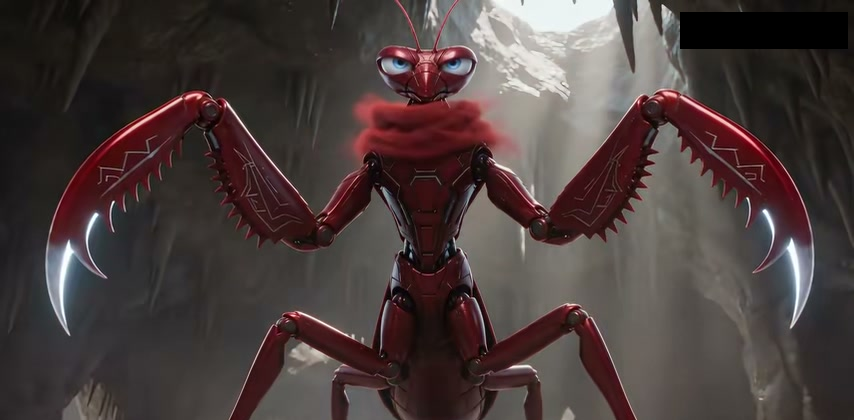
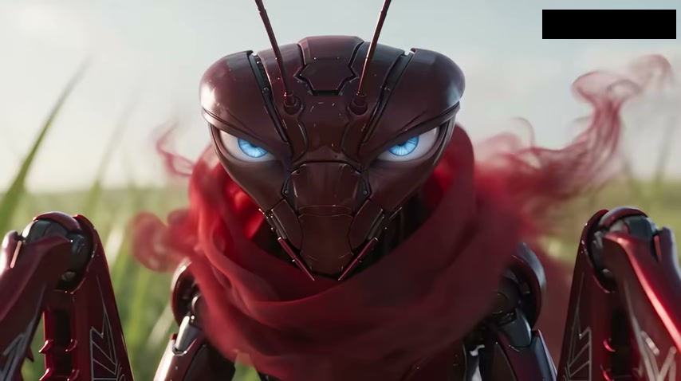

# Flint's Hunts and Evolution

## The primeval jungle

### A shared grub

Flint begins his second life as a pale green Common Mantis, Lower Tier, Grade 1. His first discovery comes over a grub he shares with Pip. Eating adds Flesh Points, and when enough accumulate, his body changes. As a Grade 2 Lightblade Mantis he stands taller, and his short Swipe becomes a Powerful Swipe. Pip sees a chance to attract the female who rules their territory. Flint has good reason to avoid her. A male who survives the courtship may still end up as his mate's next meal.

Flint begins hunting green caterpillars, but an Ironbeak Bird can still send both mantises scrambling into a hollow. Even after the bird seems to have gone, Flint is wary of sticking his head outside. It could be waiting for precisely that.

### Four caterpillar lords

Under cover of darkness Flint raids two caterpillar nests. By Lower Tier, Grade 4, his body has darkened and the blades on his forelegs are red. The surviving caterpillars assemble under four lords to avenge their kin and mates. Pip wants to move on before the swarm closes around them. Flint stays. The lords can turn his blades aside at first, but he keeps fighting until all four are dead.

There is enough for both mantises to feed. Flint emerges as a Grade 5 Blackblade Mantis with a glossy black shell, Lethal Strike and Rapid Wingflight. When he eats another ordinary green caterpillar, it gives him no experience. The prey he can now kill most easily has stopped helping him grow.

### Hunting the birds

When birds carry Pip off, Flint goes after them and kills them one by one. Among the birds he hunts is the Ironbeak that once kept both mantises pinned inside the tree. Pip can scarcely bring himself to eat a creature he has spent his life hiding from. Once he tries the meat, his own body grows.

They turn Pip's vulnerability into a hunting tactic. Pip ventures out where a bird can spot him. Flint waits out of sight and strikes when the bird comes down. The trap feeds them well enough to attract the attention of a passing female mantis. Eventually the birds learn to give that part of the forest a wide berth.

### A summons from Prism

Belle, a guard, has been sent to find strong males for Prism, the ruler of the territory. She expects Flint to come when summoned. When she invokes Prism's authority, he cuts her wing and refuses to go. Belle brings Prism word of a Grade 5 male. To Prism that makes him doubly valuable. She intends to subdue him with pheromones, mate with him and eat him to help herself advance beyond Grade 6. Flint goes looking for fresh hunting grounds.

### The ants' nursery

Flint forces an ant to give away the location of its nest. Inside, the ants raise Grade 3 grubs in numbers large enough to feed him and Pip. The soldier ants are dangerous in a group, so Flint tests how they detect intruders. Damaging their antennae lets him slip past individual guards. He brings Pip in and they feed among the grubs until Flint has the energy to reach Grade 6.

When the ant queen discovers the theft, Flint claims to be acting for Prism. Flying ants pursue him out of the nest, and soldier ants march on Prism's territory. Flint leaves Pip at the feeding grounds and doubles back. With so many defenders away, he can reach the chamber where the ants keep their Grade 4 eggs.

### A second refusal

The queen mobilizes her remaining troops when she finds him feeding on the eggs, but Flint escapes their encirclement. Prism has come to the nest herself and sees him fight. More certain than ever that he is the mate she wants, she demands his obedience in person. He refuses her a second time. Prism decides to wait a few days, when she expects her pheromones to be strong enough to overcome him.

### Empty nests

Flint gives three more enemies reason to come after Prism. He steals royal jelly, attacks the sparrows and makes sure a wild boar blames her for its severed tail. Bees, birds and the boar descend on her territory in succession. Each new arrival has a grievance of its own, and Prism cannot talk any of them out of taking revenge.

While the fighting keeps the birds away, Flint and Pip raid the Ironbeaks' nest. They make off with food before the flock's leader gets back. The Ironbeaks conclude that a more powerful group of mantises has moved against them and decide to relocate.

### The ant queen and the fall of Prism

On his next visit to the Mighty Ant nest, Flint watches the patrols, slips through a gap and follows an ant to the queen herself. She is Grade 7, but her soldiers do her fighting for her. Flint offers to spare her if she goes on laying eggs for him to eat. She refuses. He kills her, feeds and reaches Lower Tier, Grade 7.

Pip has found flower petals that leave creatures dangerously agitated. Flint names the plant Blushgrass and gathers some. When Prism tries her pheromones on him, he cuts off her antennae before they take full effect. The wild boar intervenes, and Prism calls for help. Pip delivers the fatal blow. The two mantises take the Blushgrass with them when they leave.

## The Peach Grove

### A battle outside the cave

Flint and Pip look for a cave to live in. Several Grade 6 creatures cross their path in short order, promising better hunting than the forest they left. Nearby, Green Locusts have swarmed a Grade 8 Golden-haired Monkey. Flint wades into their fight and feeds on the locusts, including the larger Green Locust King. By the time he turns on the monkey, he has reached Grade 8 himself. The monkey is already hurt. Flint kills it and carries his catch back to the cave.

### Twenty-eight challenges

The full moon brings a day when fighting is forbidden. Every creature of Grade 5 or above must bring Tree Nuts as tribute. Flint and Pip use the truce to approach Grade 8 opponents one at a time and challenge them to duels in the east of the grove the next day. They line up twenty-eight opponents. They leave a Grade 9 flying horse alone.

At the tribute gathering, white monkeys take charge of the offerings while the Bee King hunts down those who failed to attend. All act in the name of the Lord of the Peach Grove, whose authority keeps even the strongest creatures in line.

### Blushgrass at the dueling ground

Flint feeds Blushgrass to Peach Worms, then offers the worms as food to the creatures arriving for their duels. As the herb takes effect, the challengers turn on one another. Flint waits at the edge of the fighting and intercepts the wounded as they try to leave. Pip carries the bodies away. Between them they can gather food while the melee is still going on.

Bees and Longplate Bugs arrive with orders to collect corpses of their own. Some of the dead are taken to nourish a Bloodspirit Fungus. Flint keeps his part in the fighting quiet. His share of the spoils takes him to Lower Tier, Grade 9, and he sets food aside for Pip as well.

### The Bloodspirit Fungus

A night hunt takes Flint into forbidden ground. The Bee King threatens him with the wrath of the grove's lord but never brings that lord forward. What the bee gives away is the location of the fungus. It could grow more potent if left to mature. Flint takes it while he has the chance and flies beyond the Bee King's reach.

After he eats it, a cocoon forms around him. He emerges as a Second Tier, Grade 1 Bloodshadow Mantis. His shell has turned dark red. With Bloodshadow Strike and Bloodshadow Flight comes a talent called Concealment, which hides both his body and his presence. Even the flesh of Lower Tier, Grade 9 creatures now yields him no experience. Pip can still use it.

### The lord beneath the grove

The White Spirit Monkeys and the Bee King are counting on Flint needing more time to reach the Second Tier. When he returns, they have soldier bees waiting. He lets them surround him before revealing his strength. The ambushers have to tell him why the grove's lord has never come to their aid.

For twenty years a wounded White Ape has been confined underground. It has lost its reason. The monkeys and the Bee King have governed in its name, relying on the other creatures' fear of it while the fungus ripens. Flint kills them and goes underground to face the ape.

### The White Ape

The ape once stood at Second Tier, Grade 4. An arm is missing, its movements are restricted and its injuries have reduced its fighting strength to Grade 1. Its Frenzy talent still makes a direct exchange dangerous. Flint takes to the air and uses Concealment to evade its attacks. When an opening appears on its flank, he closes the distance and cuts it down. Before it dies, the ape speaks of a mantis queen in the west and a danger facing the insect races.

Flint puts off advancing until he has eaten the whole ape. A rise in grade midway through the meal could cost him experience from the remaining flesh. He then advances in succession, reaching Second Tier, Grade 3 as a Bloodthorn Mantis. Though he could take over the grove, he leaves the White Spirit Monkeys' bodies and the Bee King's extract for Pip and travels west alone.

## Insectsong Grassland

### A different kind of prey

Several insect races contest the grassland, where powerful adults commonly reach the Second Tier. On his first hunts Flint discovers why eating their flesh does so little for him. Their energy is concentrated in cores inside their bodies. He begins extracting and consuming the cores and reaches Second Tier, Grade 4.

An encounter with local mantises teaches him a rule that limits his choice of prey. Killing another mantis is forbidden. He also learns that Queen Snow is Second Tier, Grade 8 and that the grassland has no High Tier inhabitant. The cores he needs will have to come from the territory of other races.

### Gale's scouts

Flint asks Reed where the Sky-shrouding Locusts gather. Reed points him to Scarlet's camp, where the scouts keep track of enemy positions. Flint volunteers and joins Gale's intelligence squad under the name Gale Thirteen. Gale's scouts can point him straight to enemy strongholds where he can hunt for high-grade cores.

### The longhorn beetle gathering

Gale's first task is to count the Golden-armored Longhorn Beetles and find out why they have assembled. More than a hundred beetles are present, several of them Grade 4. Gale is getting ready to withdraw when Flint charges. By the time the squad can interrogate a prisoner, Flint has killed every other beetle there. The survivor gives up a plan to attack the mantis camps.

Scarlet offers Flint command of a unit. He asks to stay with the scouts. Gale can bring back the intelligence, Flint can keep the cores, and the squad can go straight on to another target.

### Night raids

A Grade 5 locust guards the next camp. Flint advances on the way there, orders his teammates to stay hidden and goes in alone after dark. His blades have changed, as Gale soon notices, and he is now Grade 5 himself. He kills the locusts so quietly that the waiting scouts have little to do.

Further missions take Flint to Grade 6. He feels the increase in strength when he strikes. Even the heavy armor of the Battle Saint Beetles fails to stop his blades. The other scouts, who once feared they might die following him, collect military credit on his hunts. He asks for harder work and takes an assignment against Grade 6 beetles gathering near their main camp.

### The beetles track him

The losses bring out the beetles' pursuit force. They spray a green liquid that clings to Flint and lets them track him after he disappears. They aim for his wings as well, hoping to keep him on the ground. He works out what the marks are doing and uses the breaks in the chase to advance again.

When he turns to fight, he is larger and has reached Second Tier, Grade 8. The beetles hunker down in their armor to wait for reinforcements. Flint cuts through it. Their Grade 8 commanders fall, and the main camp collapses. So many beetles flee into mantis territory that Scarlet initially takes the rout for an invasion. She learns what sent them running when Flint returns.

### The locust stronghold

Flint asks Scarlet to lead him to the locusts. The camp has a Grade 8 leader and enough locusts to surround him once they swarm. He attacks the strongest first. Scarlet goes back for troops, expecting the swarm to tie him down. By the time help arrives, the main engagement is over. The reinforcements deal with the survivors while Flint gathers cores from the battlefield.

### The military storehouse

Scarlet gives Flint access to her stores as a reward. A mantis can cut a core free intact with its bladed forelegs, but most mantises take a long time to absorb one. The camp has built up a considerable reserve. Flint says he has eaten less than thirty percent of it when the Grade 6 and Grade 7 cores run out. The remaining Grade 5 cores give him no experience.

The camp needs those higher grades for its own warriors. Scarlet takes Flint to the capital, where the queen can reward him from her inner treasury.

### Queen Snow's offer

Once Queen Snow has checked his victories, she offers him a camp of his own. Flint asks for dangerous assignments and access to the treasury. The queen has a place for him. The elites of nine insect races compete for the resources of the Nine Domains Sacred Land, and the mantises there need reinforcements.

The Grand Elder, a wounded Grade 9 mantis, will guide him. Before they leave, the queen allows Flint to feed in the inner treasury. She gives him one explicit order. He is to leave the Grade 9 core alone.

### The gap in the black rock

The Grand Elder finds that Flint has eaten every Grade 8 and Grade 9 core in the treasury. One belonged to the queen's foremother. Queen Snow is furious. The Grand Elder persuades her to let Flint go with him anyway. A fighter of his strength could shift the balance in the Sacred Land and win back resources for the mantises there.

The two reach a stretch of black rock under a vast whirlwind. The Grand Elder points out the gap where they can pass between the rocks. The mantises Flint has come to reinforce are on the other side.

## Field guide to Flint's forms

### Common Mantis

Lower Tier, Grade 1

Flint begins as a pale green juvenile. His eyes take up much of his rounded head. The short forelegs sit close to his chest, and thin wings lie along his slender back.

He can use Swipe and Spread Wings. His first meal, a grub he shares with Pip, earns him Flesh Points. Even as his first evolution approaches, birds remain a threat.

### Lightblade Mantis

Lower Tier, Grade 2

Flint stands taller than Pip. His shell is still green, but his body has lengthened and his wing covers reach farther down his back. The curved blades of his forelegs now have a distinct row of teeth along each inner edge.

His first evolution turns Swipe into Powerful Swipe. He hunts green caterpillars with his stronger forelegs and takes to raiding their nests at night.

### Red twin scythes

Lower Tier, Grade 4

The shell darkens from green to nearly black. His two curved scythes turn red. Closely spaced teeth run along both cutting edges and stand out when Flint opens his arms.

He reaches this grade by feeding at two caterpillar nests. When the four caterpillar lords gather against him, their defenses briefly hold off his blades. He defeats them and shares the spoils with Pip.

### Blackblade Mantis

Lower Tier, Grade 5

Flint's shell and blades turn glossy black. His cyan-blue eyes stand out against a more sharply outlined head. Both the serrated forelegs and the wing covers extend farther than before.

Feeding on the caterpillar lords brings him to this form, with Lethal Strike and Rapid Wingflight. Ordinary green caterpillars have stopped yielding experience. He takes up hunting birds, with Pip helping to lure them within reach.

### Strengthened black armor

Lower Tier, Grades 6–7

The black shell and cyan-blue eyes persist through both grades. By Grade 7 the armor on his head and forearms has angular contours. The teeth on his blades are prominent, and the dark wing covers fold along his back.

Flint reaches Grade 6 by feeding on the grubs raised by the Mighty Ants. He draws the soldiers away from the nest to get at the eggs. On his return he slips past the patrols and finds the queen. Devouring her takes him to Grade 7.

### Long black scythes

Lower Tier, Grade 8

Both scythes sweep down in long arcs. Their teeth face inward, while sharp projections jut from the outer forearms and walking legs. The blue-green eyes and the joints of his abdomen break up the dark surface of his armor.

Flint feeds on Green Locusts, including their king, while the swarm battles a Golden-haired Monkey. The locusts give him enough energy to advance. He turns on the wounded Grade 8 monkey and brings its body back to the cave.

### Pale-edged scythes

Lower Tier, Grade 9

Bright lines now run across the black plates of his chest and abdomen. Curved markings glow along the surfaces of both scythes. The cutting edges and long hooked tips shine pale white, while his eyes remain blue.

Flint reaches this grade in the Peach Grove. He has Peach Worms eat Blushgrass, then feeds them to the creatures gathered for his duels. As the fighters turn on one another, he intercepts the wounded at the edges of the melee. Pip carries away the fallen, and Flint feeds on his share to reach Grade 9.

### Bloodshadow Mantis

Second Tier, Grade 1

The black shell gives way to glossy dark red armor. Plates divide the top of the head, the eyes are blue-white, and a red trail streams behind his neck like a loose scarf. White zigzags and short feather-like markings run along his bladed forelegs. His waist stays narrow above a segmented abdomen.

After eating the Bloodspirit Fungus, Flint forms a cocoon and emerges in the Second Tier. He gains Bloodshadow Strike, Bloodshadow Flight, and the talent Concealment. Concealment hides both his body and his presence, allowing him to change position without giving away his approach.

### Bloodthorn Mantis

Second Tier, Grade 3

The scythes broaden and end in long silver-white hooks that curve downward. A continuous row of teeth follows each inner edge. The zigzag markings, blue-white eyes, and red trail behind the neck carry over from Bloodshadow. Plates divide the chest and abdomen, and the walking legs have clearly defined joints.

Flint earns this form by killing the wounded White Ape. He flies clear of its strikes, conceals himself, and closes from the side. He finishes eating before he lets himself evolve, drawing the full benefit of the flesh while still at the lower grade.

### Bloodthorn on Insectsong Grassland

Second Tier, Grades 4–8

Flint retains his segmented red head armor, blue-white eyes, and hooked blades. Gale's squad notices the change in his forelegs at Grade 5. By Grade 8, the beetles that pursued him can see that his whole body has grown larger.

Second Tier insects carry their energy in cores. Flint collects them in raids on the locusts and beetles, reaching Grade 6 as the missions grow more dangerous. During the beetle pursuit, he uses breaks in the chase to advance again. At Grade 8 his blades cut through the heavy armor of the Battle Saint Beetles.

## Evolution and combat

| Hunting ground | What feeds his growth | How he fights |
| --- | --- | --- |
| Forest and ant nest | A shared grub starts him earning Flesh Points. Caterpillar lords, birds, and the ants' food stores carry him farther. Devouring the ant queen brings him to Lower Tier, Grade 7. | Swipe develops into Powerful Swipe. As a Blackblade Mantis he has Lethal Strike and Rapid Wingflight. Pip helps him lure birds. |
| Peach Grove | Locusts and the spoils of the grove melee bring him to Lower Tier, Grade 9. The Bloodspirit Fungus takes him into the Second Tier. The White Ape sustains his next advances to Grade 3. | Bloodshadow Flight and Concealment give him a way around an opponent's guard. Against the White Ape, he stays clear of its Frenzy and strikes from the side. |
| Insectsong Grassland | Energy cores replace flesh as his main food. By Second Tier, Grade 8, the Grade 5 cores in the military storehouse no longer yield experience. | He can clear a locust camp under cover of night. The beetles mark him for pursuit with a sticky green liquid and aim for his wings to keep him grounded. His blades eventually cut through their armor. |

### Companions and current position

Pip carries spoils, acts as bait, and deals the killing blow to Prism after Flint severs her antennae. When Flint leaves for the grassland, he gives Pip the bodies of the White Spirit Monkeys and the Bee King's extract. The monkeys had used the White Ape's reputation to rule the Peach Grove. The Golden-haired Monkey that Flint killed at Grade 8 was one of his earlier catches there.

Queen Snow sends Flint to reinforce the mantises in the Nine Domains Sacred Land. He reached Second Tier, Grade 8 during the beetle pursuit. Before leaving, he eats the Grade 8 and Grade 9 cores in her inner treasury. The Grand Elder, an elderly gray mantis, accompanies him to the entrance and points out the gap between the black rocks beneath the whirlwind.
